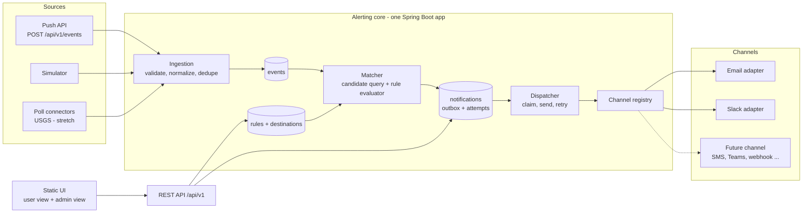
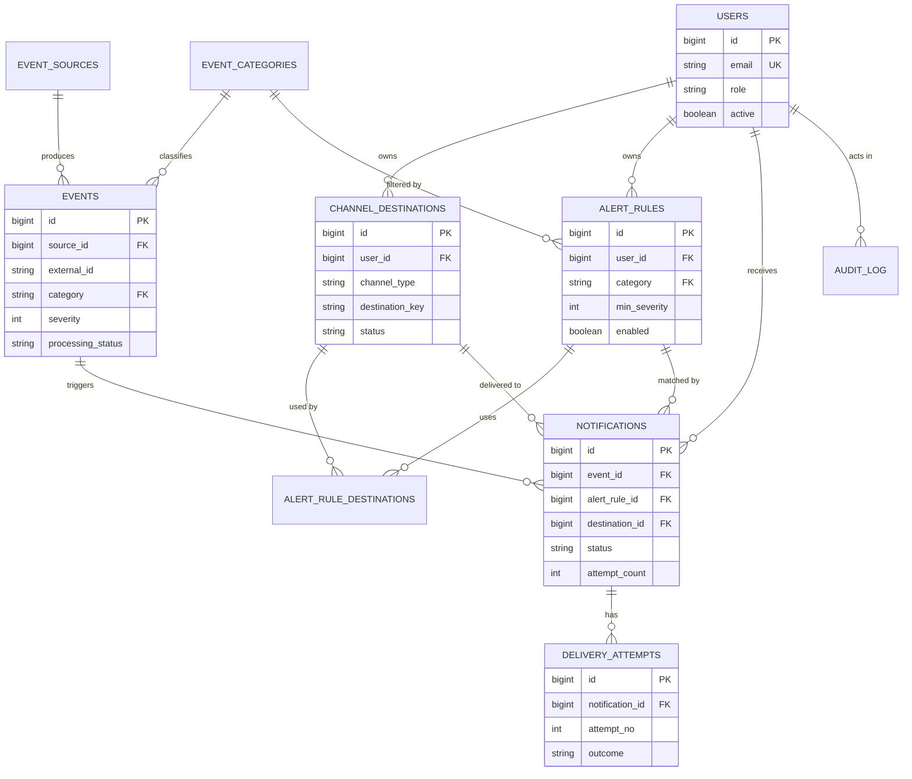
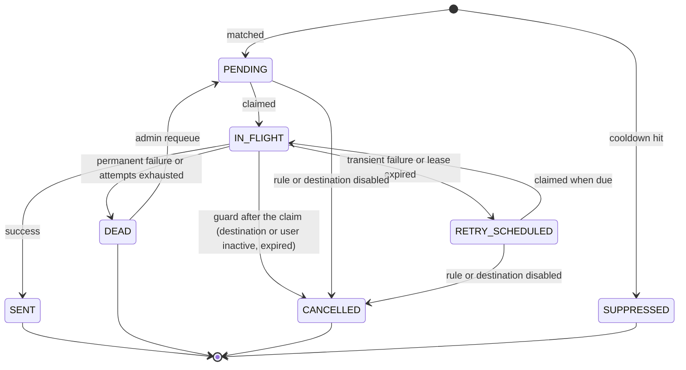
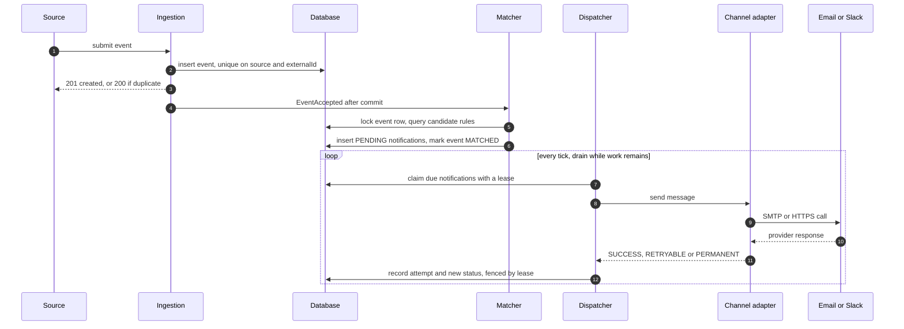

# 02 — Architecture Proposal

> **Status:** DRAFT v0.3 for review · Updated after M3 to match the build and the approvals given so far (see the change log) · **Branch:** `feature/mvp-core` · **Date:** 2026-11-10
> **Companions:** [01-PLAN-OF-ATTACK.md](01-PLAN-OF-ATTACK.md) · [03-SECURITY-OPERATIONS-DELIVERY.md](03-SECURITY-OPERATIONS-DELIVERY.md) · **Project directives:** [CLAUDE.md](../CLAUDE.md)
> Assumptions (`A-xx`), requirements (`R-xx`) and invariants (`I-x`) live in doc 01 (§10, §3, §8.3). Design decisions (`D-xx`) live here (§13). JSON snippets and property keys below are illustrative contracts, not code.

## 1. Summary

A **modular monolith**: one Spring Boot application and one database. It turns *events* into *notifications* in three durable steps. Each step is protected by a database unique key, so retries and crashes cannot duplicate or lose work.

1. **Ingest.** Sources (push API, simulator, optional pollers) submit events. An event is validated, normalized and stored once per (source, externalId).
2. **Match.** After the commit, a matcher selects the enabled rules that could apply (indexed SQL narrows the candidates, a pure in-memory evaluator decides) and writes one notification per matched rule × destination into an **outbox** table. Running the matcher again creates nothing new.
3. **Dispatch.** A scheduled dispatcher claims due notifications with a lease, sends them through the **channel registry** (Email, Slack, …), records every attempt, and marks each notification SENT, schedules a retry with backoff, or parks it as DEAD for an admin.

Channels are the extension point: one SPI discovered by dependency injection, descriptor-driven validation and UI forms, and a settings row created automatically. Adding a channel changes no core code.

## 2. Drivers, constraints and design envelope

| # | Quality attribute | Design response |
|---|---|---|
| 1 | **Correct delivery semantics**: no lost alerts, no duplicate rows, an honest analysis of residual duplicates | Transactional outbox, unique keys, leases with fenced finalize, recovery sweeper, invariants I-1 … I-9 |
| 2 | **Extensibility**: channels first, then sources, categories, conditions | Channel SPI and registry; source SPI; categories as data; a closed, tested set of condition operators |
| 3 | **Operability**: see what happened, fix what failed | Attempt ledger, admin console, metrics, health, audit log, pause switches |
| 4 | **Simplicity within 24 h** | One deployable, one database, no broker, no cache, portable SQL |
| 5 | **Testability** | Injected clock and randomness, ports for all I/O, pure logic classes, architecture tests |
| 6 | **Performance (modest)** | Indexed candidate query, JDBC-batched fan-out inserts, virtual-thread I/O |

**Constraints from CLAUDE.md:** Java 25; Spring Boot 4.1.x (A-15, approved); Spring Web, Spring Data JPA, Validation; H2 for local and PostgreSQL; Gradle; vanilla JS + Tailwind served statically.

**Design envelope (A-12):** at most 10,000 users and 100,000 rules; sustained 5 events/s with bursts to 50/s; fan-out up to 2,000 notifications per event; at least 200 deliveries/s per node; first attempt within 10 s at p95; single node by default, safe on several.

## 3. Architecture overview



### 3.1 Modules

| Module (package) | Responsibility | May depend on |
|---|---|---|
| `shared` | Clock, error types, pagination, masking helpers | — |
| `identity` | `CurrentUser` port, header-based stub resolver, role guard | `shared` |
| `user` | User entity and service (list, activate/deactivate, seed) | `shared`, `identity` |
| `event` | Event, category and source entities; ingestion use case; severity normalizers; simulator; poll-connector SPI | `shared` |
| `channel` | Channel SPI (`NotificationChannel`, descriptors, request/result types), registry, channel settings | `shared` |
| `destination` | Destination entity and service; validation by delegating to the channel registry | `shared`, `channel` |
| `rule` | Alert rule entity; criteria and condition model; rule service (CRUD, validation, quotas) | `shared`, `event` (categories), `destination` |
| `notification` | Notification and attempt entities; state machine; retry policy; dispatcher; recovery sweeper; admin operations on notifications | `shared`, `channel`, `destination`, `event`, `rule` (read) |
| `matching` | Candidate selection; pure rule evaluator; cooldown; fan-out into notifications | `shared`, `event`, `rule`, `destination`, `notification` |
| `channel.email`, `channel.slack`, `channel.dryrun` | Adapters implementing the SPI | `channel` SPI, `shared` only |
| `admin` | Stats queries, audit log, admin facade | read access to all; `notification` operations |
| `web` | Controllers, DTOs, exception handler, static resources | application services only |

### 3.2 Package skeleton (illustrative)

```text
com.example.alerting            (placeholder, A-20)
  shared/        clock, errors, paging, masking
  identity/      CurrentUser port, header stub, role guard
  user/
  event/         ingestion, normalizers, simulator, connector SPI
  channel/       SPI, registry, settings
    email/  slack/  dryrun/
  destination/
  rule/          rule + criteria model
  notification/  outbox, state machine, retry, dispatcher, sweeper
  matching/      candidate query, evaluator, cooldown, fan-out
  admin/         stats, audit
  web/           controllers, DTOs, error handling
src/main/resources/
  db/migration/  Flyway scripts (V1 schema, V2 reference data)
  db/dev/        demo data (local profile only)
  static/        index.html, app modules, prebuilt CSS
```

### 3.3 Layering rules (enforced by architecture tests, D-32; invariant I-8)

1. `web` depends on application services only. Nothing depends on `web`.
2. Adapters (`channel.email`, `channel.slack`, `channel.dryrun`) depend only on the `channel` SPI and `shared`. Core modules never import adapters.
3. No cycles between top-level modules. Cross-module reactions use in-process application events. For example `rule` and `destination` publish `RuleDisabled` and `DestinationDisabled`; `notification` handles them and cancels pending work.
4. Pure-logic classes (`RuleEvaluator`, `RetryPolicy`, `NotificationStateMachine`, the severity normalizers, the cooldown decision) import no Spring, JPA or I/O types.
5. Entities are never returned from controllers; DTOs only.

### 3.4 Runtime topology

One JVM runs HTTP threads, a bounded asynchronous matcher executor, and two scheduled loops (`dispatch` tick and `recovery` tick). Outbound I/O runs on virtual threads, each channel guarded by a semaphore (bulkhead). On Java 25, virtual threads no longer pin on `synchronized` (JEP 491), so blocking mail and HTTP clients are safe to use this way. Every node runs every loop; leases make that safe.

## 4. Domain model

### 4.1 Glossary

| Term | Meaning |
|---|---|
| **Event** | An immutable, normalized record of something that happened in the world. |
| **Source** | Where events come from: the push API, the simulator, or a poll connector. |
| **Category** | A coarse class of event (NEWS, MARKET, DISASTER), stored as data. |
| **Severity** | Importance score 1–5 assigned at ingestion: 1 INFO, 2 LOW, 3 MEDIUM, 4 HIGH, 5 CRITICAL. |
| **Alert rule** | A user's saved question: "tell me when an event like this happens". |
| **Criteria** | The refinements inside a rule: regions, keywords, attribute conditions. |
| **Destination** | A user's contact point on a channel: an email address or a Slack webhook. |
| **Channel** | A delivery mechanism (EMAIL, SLACK, …) implemented by an adapter. |
| **Notification** | One intended delivery of one event to one destination because of one rule. It is the outbox row. |
| **Attempt** | One try to deliver a notification. Append-only. |
| **Cooldown** | Minimum time between alerts produced by the same rule. |
| **Lease** | A time-limited claim on a notification by one worker. |
| **Dead letter** | A notification that will not be retried automatically (status DEAD). |

### 4.2 Relationships

A **user** owns **destinations** and **rules**. A rule references one category and one or more of its owner's destinations. A **source** produces **events** of a category. When an event matches a rule, one **notification** is created for each destination of that rule (event × rule × destination). A notification accumulates **delivery attempts**. The ER diagram is in §5.2.

### 4.3 Aggregates and invariants

| Aggregate (root) | Invariants | Enforced by |
|---|---|---|
| **User** | Email unique, stored lower-case. Inactive users receive nothing. | Unique constraint; dispatch-time guard |
| **Destination** | Belongs to one user. (user, channel type, destination key) is unique among live rows. Config is valid for its channel. Secret fields are masked on output. | Unique constraint; channel validation; response mappers |
| **Alert rule** | Belongs to one user. One category. Min severity 1–5. Counts within quotas. At least one live destination while enabled, all owned by the same user. | Service validation; CHECK constraints |
| **Event** | Immutable after insert (only processing-status fields change). Unique (source, externalId). Severity 1–5. | Unique and CHECK constraints; entity exposes no mutators for business fields |
| **Notification** | Unique (event, rule, destination). Status changes only through the state machine. `attempt_count` never decreases. Terminal states are final, except DEAD → PENDING by an admin. | Unique constraint; state machine (unit-tested); conditional updates |
| **Delivery attempt** | Append-only. (notification, attempt number) unique. | Unique constraint; no update API |

### 4.4 Value objects and enumerations

- **Severity**: integer 1–5 with names INFO, LOW, MEDIUM, HIGH, CRITICAL.
- **Region**: upper-case code such as `JP` or `US-CA`. Hierarchical by hyphen: a rule region `US` matches `US` and `US-*`.
- **Criteria**: `regions[]`, `keywords[]`, `conditions[]`. **Condition**: `{field, op, value}`.
- **DestinationConfig**: channel-specific map (EMAIL `address`; SLACK `webhookUrl`). Secret keys are flagged by the channel descriptor.
- **AlertMessage**: channel-neutral content: title, summary, severity, category, region, url, occurredAt, rule name, notification reference.
- **DeliveryResult**: outcome SUCCESS, RETRYABLE or PERMANENT, plus `errorCode`, short message, optional `retryAfter`, optional `providerMessageId`.
- **Enumerations**: `NotificationStatus` (PENDING, IN_FLIGHT, RETRY_SCHEDULED, SENT, DEAD, CANCELLED, SUPPRESSED); `AttemptOutcome` (SUCCESS, RETRYABLE_FAILURE, PERMANENT_FAILURE, LEASE_EXPIRED); `EventProcessingStatus` (RECEIVED, MATCHED, SKIPPED_STALE, FAILED); `Role` (USER, ADMIN); `SourceType` (PUSH, POLL, SIMULATED).

### 4.5 Domain services

| Component | Kind | Responsibility |
|---|---|---|
| `EventIngestionService` | Orchestration | Validate, normalize, dedupe, persist, publish `EventAccepted` after commit |
| `SeverityNormalizer` (per category) | Pure strategy | Derive severity and derived attributes from raw attributes |
| `EventMatcher` | Orchestration (one transaction per event) | Lock the event, select candidates, evaluate, apply cooldown, create notifications, mark the event |
| `RuleEvaluator` | Pure | Event × rule → match result with reasons |
| `NotificationStateMachine` | Pure | Legal transitions and their guards |
| `RetryPolicy` | Pure | Classify an outcome and compute the next attempt time |
| `NotificationDispatcher` | Orchestration | Claim, guard, render, send, finalize |
| `ChannelRegistry` | Infrastructure | Channel type → adapter, descriptors, startup validation, settings rows |
| `RecoverySweeper` | Orchestration | Return stale leases to the queue; re-run matching for stuck events |
| `AdminOperations` | Orchestration | Requeue, cancel, pause/resume, toggles; always writes an audit row |

## 5. Database schema

### 5.1 Conventions

- **Portable SQL (A-17).** One Flyway migration set for H2 (PostgreSQL mode) and PostgreSQL. No partial or expression indexes, no jsonb operators, no `SKIP LOCKED`, no arrays.
- **Keys.** `BIGINT` from one sequence per table with `INCREMENT BY 50` (Hibernate pooled optimizer) instead of IDENTITY, so fan-out inserts can be JDBC-batched. `event_categories` and `channel_settings` use natural keys.
- **Time.** `TIMESTAMP WITH TIME ZONE`, UTC instants only.
- **Enumerations.** `VARCHAR` with a CHECK constraint, mapped as strings.
- **JSON.** Stored as `VARCHAR(n)` text, size-limited at the API, never queried with JSON operators.
- **Soft delete.** `deleted_at` on rules and destinations. **Optimistic locking:** `version` on rules, destinations and notifications.
- **Mapping check.** `ddl-auto=validate` in every profile, so entity mappings must match the migrations.

### 5.2 Entity-relationship overview



`channel_settings` is keyed by the channel type code and is related to destinations logically (no foreign key), because its rows are created by the registry at startup.

### 5.3 Tables

**`users`**

| Column | Type | Constraints / notes |
|---|---|---|
| id | BIGINT | PK (sequence) |
| email | VARCHAR(320) | NOT NULL, UNIQUE, stored lower-case |
| display_name | VARCHAR(100) | NOT NULL |
| role | VARCHAR(10) | NOT NULL, CHECK in (USER, ADMIN) |
| active | BOOLEAN | NOT NULL, default TRUE |
| created_at, updated_at | TIMESTAMP WITH TIME ZONE | NOT NULL |

**`event_categories`** (reference data)

| Column | Type | Constraints / notes |
|---|---|---|
| code | VARCHAR(30) | PK, for example NEWS, MARKET, DISASTER |
| display_name | VARCHAR(80) | NOT NULL |
| description | VARCHAR(300) | |
| enabled | BOOLEAN | NOT NULL, default TRUE |

**`event_sources`**

| Column | Type | Constraints / notes |
|---|---|---|
| id | BIGINT | PK |
| code | VARCHAR(50) | NOT NULL, UNIQUE: `manual`, `simulator`, `usgs-earthquakes` |
| name | VARCHAR(100) | NOT NULL |
| type | VARCHAR(12) | NOT NULL, CHECK in (PUSH, POLL, SIMULATED) |
| enabled | BOOLEAN | NOT NULL, default TRUE |
| config | VARCHAR(2000) | NOT NULL, default `{}`; JSON text |
| last_success_at, last_error_at | TIMESTAMP WITH TIME ZONE | NULL |
| last_error | VARCHAR(500) | NULL |
| created_at | TIMESTAMP WITH TIME ZONE | NOT NULL |

**`events`**

| Column | Type | Constraints / notes |
|---|---|---|
| id | BIGINT | PK |
| source_id | BIGINT | NOT NULL, FK → event_sources |
| external_id | VARCHAR(200) | NOT NULL; supplied by the source or derived (§6.5) |
| category | VARCHAR(30) | NOT NULL, FK → event_categories |
| severity | SMALLINT | NOT NULL, CHECK between 1 and 5 |
| title | VARCHAR(300) | NOT NULL |
| summary | VARCHAR(2000) | NULL |
| url | VARCHAR(2000) | NULL; http(s) only |
| region | VARCHAR(50) | NULL; stored upper-case |
| occurred_at | TIMESTAMP WITH TIME ZONE | NOT NULL |
| received_at | TIMESTAMP WITH TIME ZONE | NOT NULL |
| attributes | VARCHAR(8000) | NOT NULL, default `{}`; JSON object of scalar values |
| processing_status | VARCHAR(16) | NOT NULL, CHECK in (RECEIVED, MATCHED, SKIPPED_STALE, FAILED) |
| matched_at | TIMESTAMP WITH TIME ZONE | NULL |
| match_count | INT | NOT NULL, default 0; notifications created, including suppressed |
| match_attempts | INT | NOT NULL, default 0 |
| match_error | VARCHAR(500) | NULL |

UNIQUE (source_id, external_id).

**`channel_destinations`**

| Column | Type | Constraints / notes |
|---|---|---|
| id | BIGINT | PK |
| user_id | BIGINT | NOT NULL, FK → users |
| channel_type | VARCHAR(30) | NOT NULL; registry code such as EMAIL or SLACK |
| label | VARCHAR(100) | NOT NULL |
| config | VARCHAR(2000) | NOT NULL; JSON text; secret fields flagged by the descriptor |
| destination_key | VARCHAR(255) | NOT NULL; canonical identity from the adapter (lower-cased address; SHA-256 of the webhook URL) |
| status | VARCHAR(10) | NOT NULL, CHECK in (ACTIVE, DISABLED) |
| deleted_at | TIMESTAMP WITH TIME ZONE | NULL |
| created_at, updated_at | TIMESTAMP WITH TIME ZONE | NOT NULL |
| version | BIGINT | NOT NULL (optimistic lock) |

UNIQUE (user_id, channel_type, destination_key). Re-creating a soft-deleted destination revives it. INDEX (user_id).

**`alert_rules`**

| Column | Type | Constraints / notes |
|---|---|---|
| id | BIGINT | PK |
| user_id | BIGINT | NOT NULL, FK → users |
| name | VARCHAR(120) | NOT NULL |
| description | VARCHAR(500) | NULL |
| category | VARCHAR(30) | NOT NULL, FK → event_categories |
| min_severity | SMALLINT | NOT NULL, default 1, CHECK between 1 and 5 |
| criteria | VARCHAR(4000) | NOT NULL, default `{}`; JSON text: `regions`, `keywords`, `conditions` |
| cooldown_seconds | INT | NOT NULL, default 0, CHECK between 0 and 86400 |
| enabled | BOOLEAN | NOT NULL, default TRUE |
| last_triggered_at | TIMESTAMP WITH TIME ZONE | NULL; cooldown anchor |
| deleted_at | TIMESTAMP WITH TIME ZONE | NULL |
| created_at, updated_at | TIMESTAMP WITH TIME ZONE | NOT NULL |
| version | BIGINT | NOT NULL |

INDEX (category, enabled, min_severity) serves the candidate query. INDEX (user_id).

**`alert_rule_destinations`**

| Column | Type | Constraints / notes |
|---|---|---|
| rule_id | BIGINT | NOT NULL, FK → alert_rules |
| destination_id | BIGINT | NOT NULL, FK → channel_destinations |

PK (rule_id, destination_id). INDEX (destination_id).

**`notifications`** (the outbox)

| Column | Type | Constraints / notes |
|---|---|---|
| id | BIGINT | PK |
| event_id | BIGINT | NOT NULL, FK → events |
| alert_rule_id | BIGINT | NOT NULL, FK → alert_rules |
| destination_id | BIGINT | NOT NULL, FK → channel_destinations |
| user_id | BIGINT | NOT NULL, FK → users; denormalized for history queries and guards |
| channel_type | VARCHAR(30) | NOT NULL; copied from the destination at match time so routing needs no join |
| status | VARCHAR(16) | NOT NULL, CHECK in (PENDING, IN_FLIGHT, RETRY_SCHEDULED, SENT, DEAD, CANCELLED, SUPPRESSED) |
| status_reason | VARCHAR(60) | NULL: COOLDOWN, RULE_DISABLED, DESTINATION_DISABLED, USER_INACTIVE, ADMIN_CANCEL, EXPIRED, UNKNOWN_CHANNEL, PERMANENT_FAILURE, ATTEMPTS_EXHAUSTED |
| attempt_count | INT | NOT NULL, default 0; incremented when a worker claims the notification |
| max_attempts | INT | NOT NULL; set at creation from policy; an admin requeue raises it |
| next_attempt_at | TIMESTAMP WITH TIME ZONE | NOT NULL; initially the creation time |
| locked_by | VARCHAR(100) | NULL; worker id |
| locked_until | TIMESTAMP WITH TIME ZONE | NULL; lease expiry |
| last_error_code | VARCHAR(50) | NULL |
| last_error_message | VARCHAR(500) | NULL |
| created_at, updated_at | TIMESTAMP WITH TIME ZONE | NOT NULL |
| sent_at | TIMESTAMP WITH TIME ZONE | NULL |
| version | BIGINT | NOT NULL |

UNIQUE (event_id, alert_rule_id, destination_id).

**`delivery_attempts`**

| Column | Type | Constraints / notes |
|---|---|---|
| id | BIGINT | PK |
| notification_id | BIGINT | NOT NULL, FK → notifications |
| attempt_no | INT | NOT NULL |
| started_at, finished_at | TIMESTAMP WITH TIME ZONE | NOT NULL |
| outcome | VARCHAR(24) | NOT NULL, CHECK in (SUCCESS, RETRYABLE_FAILURE, PERMANENT_FAILURE, LEASE_EXPIRED) |
| error_code | VARCHAR(50) | NULL |
| error_message | VARCHAR(500) | NULL; truncated, never contains secrets |
| http_status | INT | NULL |
| latency_ms | INT | NOT NULL |
| provider_message_id | VARCHAR(200) | NULL; Email: Message-ID; DRY_RUN: `dry-run` |
| worker_id | VARCHAR(100) | NOT NULL |

UNIQUE (notification_id, attempt_no).

**`channel_settings`**

| Column | Type | Constraints / notes |
|---|---|---|
| channel_type | VARCHAR(30) | PK |
| enabled | BOOLEAN | NOT NULL, default TRUE; the admin pause switch |
| max_attempts | INT | NULL; per-channel override of the retry budget |
| updated_at | TIMESTAMP WITH TIME ZONE | NOT NULL |
| updated_by | BIGINT | NULL, FK → users |

Rows are created by the registry at startup for every discovered channel, so adding a channel needs no migration.

**`audit_log`**

| Column | Type | Constraints / notes |
|---|---|---|
| id | BIGINT | PK |
| actor_user_id | BIGINT | NOT NULL, FK → users |
| action | VARCHAR(60) | NOT NULL, for example REQUEUE_NOTIFICATION, PAUSE_CHANNEL |
| target_type | VARCHAR(40) | NOT NULL |
| target_id | VARCHAR(64) | NOT NULL |
| details | VARCHAR(2000) | NULL; JSON text |
| created_at | TIMESTAMP WITH TIME ZONE | NOT NULL |

INDEX (created_at).

### 5.4 Indexes and constraints that matter

| Purpose | Index or constraint |
|---|---|
| Event idempotency | `events` UNIQUE (source_id, external_id) |
| Notification idempotency (I-1) | `notifications` UNIQUE (event_id, alert_rule_id, destination_id) |
| Attempt ledger integrity | `delivery_attempts` UNIQUE (notification_id, attempt_no) |
| Candidate rule query | `alert_rules` (category, enabled, min_severity) |
| Dispatcher claim | `notifications` (status, next_attempt_at) |
| Lease sweeper | `notifications` (status, locked_until) |
| Unmatched-event sweeper | `events` (processing_status, received_at) |
| User history | `notifications` (user_id, created_at) |
| Admin filters and stats | `notifications` (channel_type, status), (alert_rule_id), (event_id); `events` (category, occurred_at) |
| Destination de-duplication | `channel_destinations` UNIQUE (user_id, channel_type, destination_key) |

### 5.5 Key queries (predicates, not full SQL)

- **Candidate rules.** Rules where category = event category, enabled, not deleted, min_severity ≤ event severity, owner active, and with at least one live ACTIVE destination. Read in pages of 500 keyed by id. Destinations are loaded per page with one `IN` query.
- **Due notifications.** Status in (PENDING, RETRY_SCHEDULED), next_attempt_at ≤ now, channel not paused, ordered by (next_attempt_at, id), limited to the batch size.
- **Claim (per notification).** One conditional update: set status IN_FLIGHT, locked_by, locked_until, attempt_count + 1, version + 1 where id matches and status is still PENDING or RETRY_SCHEDULED and next_attempt_at ≤ now. One affected row means the claim succeeded.
- **Finalize.** One conditional update guarded by id, status IN_FLIGHT and locked_by = this worker (the fence), plus the attempt insert, in one short transaction.
- **Stale leases.** Status IN_FLIGHT and locked_until < now.
- **Stats.** Counts grouped by status and channel; oldest PENDING age; attempt outcomes over the last hour.

### 5.6 Migration plan

| Script | Content | Profile |
|---|---|---|
| `V1__schema` | All tables, sequences, constraints, indexes | all |
| `V2__reference_data` | Categories NEWS, MARKET, DISASTER; sources `manual` (PUSH), `simulator` (SIMULATED), `usgs-earthquakes` (POLL, disabled). Channel settings are not seeded: the channel registry creates them at start-up (§5.3) | all |
| `db/dev/R__demo_users` | Demo users (admin, alice, bob at `example.com` addresses); repeatable and idempotent (built in M2) | `local` only |
| `db/dev/R__demo_users_samples` | Sample destinations and rules for alice and bob, in DRY_RUN (planned for M4, A-34). Repeatable scripts run in name order, so this one runs after the users script | `local` only |

## 6. Events: what "important" means and how events arrive

### 6.1 Definition

An **event** is an immutable, normalized fact: *something of a given category happened at a given time, with an importance score*. "Important" has two layers (A-03):

1. **Source-level importance.** The ingestion step assigns a normalized `severity` from 1 to 5, either supplied by the source or derived by a per-category normalizer from the event's attributes.
2. **User-level importance.** Each user's rules decide which severities, regions, keywords and attribute thresholds matter to them.

The system makes no editorial judgment. An event that no rule matches is stored and notifies nobody.

| Field | Type | Required | Rules |
|---|---|---|---|
| `source` | string | no (default `manual`) | An enabled source code, matched exactly (case-sensitive). Unknown: 400 `SOURCE_INVALID`. Disabled: 409 `SOURCE_DISABLED` |
| `externalId` | string ≤ 200 | no | If absent it is derived (§6.5) so that naive clients are still idempotent. Present but blank is an error |
| `category` | string | yes | Must exist and be enabled; matched exactly (case-sensitive) |
| `severity` | integer 1–5 | yes, unless the category has a normalizer and the attributes it needs | A whole number: `4.5` and `"4"` are rejected |
| `title` | string ≤ 300 | yes | Trimmed, non-blank, control characters removed |
| `summary` | string ≤ 2000 | no | Line breaks and tabs are kept, other control characters removed; blank counts as absent |
| `url` | string ≤ 2000 | no | Absolute http or https URL; the service never fetches it |
| `region` | string ≤ 50 | no | Letters, digits, `_` and `-`; stored upper-case; blank counts as absent |
| `occurredAt` | ISO-8601 instant | yes | Sent as text; a number is rejected. At most 5 minutes in the future (clock skew); no lower bound, staleness is decided when matching (§6.6) |
| `attributes` | object of scalars | no | At most 8,000 characters serialized, derived attributes (§6.2) included. Keys match `[A-Za-z][A-Za-z0-9_]{0,39}`. Values are string, finite number or boolean; no nulls, nesting or arrays. |

The JSON is strict (A-29): unknown fields, a number where text is expected (or the reverse), and a fractional or quoted number for an integer are rejected, so typos and type slips do not pass silently.

Illustrative event:

```json
{
  "source": "manual",
  "externalId": "demo:quake-0001",
  "category": "DISASTER",
  "severity": 4,
  "title": "M 6.4 earthquake near Hualien, Taiwan",
  "summary": "Shallow quake at 10 km depth. No tsunami warning issued.",
  "url": "https://example.com/events/quake-0001",
  "region": "TW",
  "occurredAt": "2026-11-10T08:12:00Z",
  "attributes": { "magnitude": 6.4, "depthKm": 10, "tsunami": false, "place": "Hualien, Taiwan" }
}
```

### 6.2 Severity scale and default normalization

Scale: **1 INFO, 2 LOW, 3 MEDIUM, 4 HIGH, 5 CRITICAL**. The mappings below are defaults to challenge; thresholds are configuration, not code.

| Category | Input signal | Mapping | Derived attributes |
|---|---|---|---|
| DISASTER (earthquake) | `magnitude` | below 4.0 → 1; 4.0–4.9 → 2; 5.0–5.9 → 3; 6.0–6.9 → 4; 7.0 and above → 5. `tsunami = true` adds 1 (maximum 5). | — |
| MARKET | `changePct` (signed percent move against the previous close) | absolute move below 1 → 1; 1 to below 2 → 2; 2 to below 5 → 3; 5 to below 10 → 4; 10 and above → 5 | `moveMagnitudePct` (absolute value), `direction` (UP or DOWN; FLAT for a move of exactly zero, A-30) |
| NEWS | `breaking`, `developing` (booleans), `minor` (boolean) | breaking → 4; developing → 3; minor → 1; otherwise 2 | — |
| any other category | — | `severity` must be supplied | — |

A supplied `severity` always wins over a derived one. Derived attributes are added only when absent.

### 6.3 Categories

Categories are rows in `event_categories`, seeded with NEWS, MARKET and DISASTER. Adding one is a data change (admin API as a could-have) and needs no deployment. A category without a normalizer simply requires an explicit `severity`. Attribute names per category are conventions, documented in the README (DISASTER: `magnitude`, `depthKm`, `tsunami`, `place`; MARKET: `symbol`, `changePct`, `moveMagnitudePct`, `price`; NEWS: `publisher`, `topics`, `breaking`).

### 6.4 Sources and ingestion paths

| Path | Role | Description | Milestone |
|---|---|---|---|
| **Push API** `POST /api/v1/events` | ADMIN (A-10) | The generic entry point; used by the admin UI's "publish event", by tests and by any external system | M3 |
| **Simulator** | ADMIN | Deterministic (seeded) generators for the three categories; endpoint `POST /api/v1/admin/simulator/run` | M3 (service), M6 (endpoint) |
| **Poll connectors** | system | `EventSourceConnector` SPI: given a cursor, return normalized events. A scheduler runs each enabled POLL source on its interval and records `last_success_at` / `last_error`. | stretch |

All paths converge on one use case, `EventIngestionService.ingest(normalizedEvent)`, so validation, idempotency and matching are identical no matter where an event came from.

### 6.5 Ingestion pipeline

1. **Authorize.** Admin role (stub identity, A-10).
2. **Validate.** Strict JSON, then a validator that collects every field problem so the sender can fix a payload in one round trip (D-33); field limits; reject future-dated events beyond the skew. A body that cannot be read at all (broken JSON, an unknown field, a wrong type) is reported first, before the field rules are checked.
3. **Resolve.** Source and category must exist and be enabled.
4. **Normalize.** Trim; upper-case region; derive severity and derived attributes; if `externalId` is absent derive it as the SHA-256 of category, title, occurredAt and region, prefixed `h:` (same payload → same id).
5. **Dedupe and persist.** Look up (source, externalId). If found, answer 200 with the existing event, whatever its current status, and ignore any difference in the payload (A-05). Otherwise insert with status RECEIVED in a short transaction of its own, even if the caller already has one (D-34). A unique-violation race is caught outside the transaction, the row is re-read, and the answer is 200.
6. **Publish.** After commit, `EventAccepted(eventId)` is handed to the bounded matcher executor. A failing listener never turns the committed ingestion into an error (A-31); the recovery sweeper picks the event up.
7. **Respond.** `201 {id, status: "RECEIVED", duplicate: false}` (or `200 … duplicate: true`).

| Failure | Response / behavior |
|---|---|
| Invalid payload | 400 `application/problem+json` with code `VALIDATION_FAILED` and per-field errors; a body that is missing or not JSON is `MALFORMED_REQUEST` |
| Unknown or disabled category | 400 with code `CATEGORY_INVALID` |
| Unknown source | 400 with code `SOURCE_INVALID` |
| Disabled source | 409 with code `SOURCE_DISABLED` |
| Body too large | 413 with code `PAYLOAD_TOO_LARGE` above 64 KB (`alerting.http.max-request-body-bytes`), also for chunked bodies without a declared length |
| Database unavailable | 503 with `Retry-After`; nothing was accepted, so the sender may retry safely |
| Matcher fails after commit | Event stays RECEIVED; the recovery sweeper retries up to 5 times, then marks it FAILED (visible in the admin console) |

### 6.6 Immutability, revisions and staleness

- **Immutable (A-05).** A later submission with the same (source, externalId) is a duplicate and is ignored. Revisions (for example a revised magnitude) are an evolution item.
- **Stale events (A-14).** At match time, if `occurredAt` is older than the freshness window (default 6 h), the event gets status SKIPPED_STALE and creates no notifications.

### 6.7 Stretch connector: USGS earthquakes

The public GeoJSON summary feeds are free and key-less. Feature mapping:

| Event field | From |
|---|---|
| `externalId` | `usgs:` + feature id |
| `title` | `properties.title` |
| `occurredAt` | `properties.time` (epoch milliseconds) |
| `url` | `properties.url` |
| `category` / `severity` | DISASTER / derived from `properties.mag` (§6.2) |
| `attributes` | `magnitude`, `depthKm` (third coordinate), `tsunami`, `place`, `pagerAlert` (`properties.alert`) |
| `region` | not provided by the feed; left empty. Rules use `attributes.place` CONTAINS "Japan" instead. |

This is a concrete reason the rule model supports attribute conditions.

## 7. Rule matching

### 7.1 Rule anatomy

| Field | Meaning | Default |
|---|---|---|
| `name`, `description` | Human labels | — |
| `category` | Exactly one category (A-06) | required |
| `minSeverity` | Event severity must be at least this | 1 |
| `criteria.regions[]` | Any-of; `US` matches `US` and `US-*` | none (no region constraint) |
| `criteria.keywords[]` | Any-of; case-insensitive whole word or phrase in title + summary | none |
| `criteria.conditions[]` | All-of attribute conditions (§7.2) | none |
| `cooldownSeconds` | Minimum seconds between alerts from this rule | 0 (off) |
| `destinationIds[]` | One to ten live destinations owned by the same user | required |
| `enabled` | Whether the rule participates in matching | true |

Illustrative rule:

```json
{
  "name": "Big quakes in East Asia",
  "category": "DISASTER",
  "minSeverity": 4,
  "criteria": {
    "regions": ["JP", "TW", "KR"],
    "keywords": [],
    "conditions": [ { "field": "attributes.magnitude", "op": "GTE", "value": 6.0 } ]
  },
  "cooldownSeconds": 300,
  "destinationIds": [1, 2]
}
```

**What `destinationIds` contains.** The numbers are the ids of the user's own **destinations**: rows of `channel_destinations`, created through `POST /destinations` and listed by `GET /destinations`. They are not channel ids. A *channel* is only a type code (`EMAIL`, `SLACK`); a *destination* says where on that channel to deliver. In the rule above, `1` and `2` could be these two destinations of the same user (illustrative `GET /destinations` response):

```json
[
  { "id": 1, "channelType": "SLACK", "label": "ops-alerts", "status": "ACTIVE",
    "config": { "webhookUrl": "https://hooks.slack.com/services/…/****" } },
  { "id": 2, "channelType": "EMAIL", "label": "my inbox", "status": "ACTIVE",
    "config": { "address": "alice@example.com" } }
]
```

Why ids and not channel names: a user can have several destinations on the same channel (two Slack channels, a work and a personal address), so the channel type alone cannot say where to send. Each id must exist, belong to the same user and be ACTIVE (not deleted). A rule needs one to ten of them; otherwise the API answers 400 with the code `DESTINATION_NOT_FOUND` (the same answer for unknown and foreign ids, so other users' ids cannot be probed). One matched event creates one notification for each listed destination (§7.3 step 7). The UI shows destination labels as checkboxes, so ids are an API detail.

Limits (quotas): 100 rules and 20 destinations per user; 10 destinations, 20 keywords, 20 regions and 10 conditions per rule; keyword length 50.

### 7.2 Semantics

A rule matches an event when **all** of these hold:

| Criterion | Matches when | If the rule leaves it empty | If the event lacks the data |
|---|---|---|---|
| category | equal | — | — |
| severity | event severity ≥ `minSeverity` | any severity | — |
| regions | event region equals a listed region or starts with it plus `-` | no constraint | event has no region → no match |
| keywords | at least one keyword appears as a whole word or phrase in `lower(title + " " + summary)` | no constraint | — |
| conditions | every condition is true | no constraint | missing attribute → that condition is false |
| cooldown | the atomic cooldown check succeeds (§7.3 step 6) | always succeeds | — |

**Fields** a condition may reference: `severity`, `region`, `title`, `summary`, `attributes.<key>`.

**Operators:** `EQ`, `NEQ`, `GT`, `GTE`, `LT`, `LTE`, `IN` (value is a list), `CONTAINS` (strings), `EXISTS` (field present).

Typing rules: numbers compare numerically (decimal). Strings compare case-insensitively for `EQ`, `NEQ`, `IN`, `CONTAINS`. Booleans support `EQ` and `NEQ` only. A type mismatch makes the condition false and increments `alerting.rule.eval.type_mismatch`. There are no user-supplied regular expressions (no ReDoS surface) and no expression language (D-04).

### 7.3 Algorithm (one transaction per event)

1. **Lock.** `SELECT … FOR UPDATE` on the event row. If its status is no longer RECEIVED, stop (another matcher finished it; I-1).
2. **Freshness.** If `occurredAt` is older than the freshness window, set SKIPPED_STALE and stop (A-14).
3. **Existing work.** Load the (rule, destination) pairs that already have notifications for this event. This makes re-runs idempotent; the unique key is the backstop.
4. **Candidates.** Page through candidate rules (§5.5). In-memory evaluation of rules is O(conditions) each; the SQL narrows by category and severity first.
5. **Evaluate.** `RuleEvaluator` (pure) returns matched or not, with reasons. A rule whose stored criteria cannot be parsed is skipped, counted in `alerting.rule.invalid`, and flagged in the admin rule overview; it never fails the event.
6. **Cooldown.** For each matched rule whose pairs are not all present yet: if `cooldownSeconds` is 0, proceed. Otherwise run an atomic conditional update on the rule row that sets `last_triggered_at = now` only if it is empty or older than `now − cooldown`. One affected row → proceed. Zero → the rule is in cooldown.
7. **Fan-out.** For a proceeding rule, insert one PENDING notification per live destination (`next_attempt_at = now`, `max_attempts` from policy). For a rule in cooldown, insert SUPPRESSED rows with reason COOLDOWN, so users and admins can see why no alert arrived (D-17). Inserts are JDBC-batched in chunks of 500.
8. **Finish.** Set the event MATCHED with `matched_at` and `match_count`, and commit. Cooldown updates, notifications and the event status commit or roll back together.

On any exception the transaction rolls back and the event stays RECEIVED. A separate small transaction increments `match_attempts` and stores `match_error`. After 5 failures the event becomes FAILED.

### 7.4 Worked example

Event E: DISASTER, severity 4, region `TW`, `attributes.magnitude = 6.4`, occurred 2 minutes ago.

| Rule (owner) | Definition | Candidate? | Result |
|---|---|---|---|
| R1 (Alice) | DISASTER, severity ≥ 4, regions JP/TW/KR, magnitude ≥ 6, cooldown 300 s, Slack + Email | yes | **match**; cooldown acquired → 2 PENDING notifications |
| R2 (Bob) | DISASTER, severity ≥ 5 | no (min severity 5 > 4) | — |
| R3 (Carol) | DISASTER, severity ≥ 3, region US | yes | no: region mismatch |
| R4 (Dan) | DISASTER, severity ≥ 1, keyword "volcano" | yes | no: keyword absent |
| R5 (Alice) | DISASTER, severity ≥ 4, no other criteria, Email | yes | **match** → 1 PENDING notification |

Result for E: R1 and R5 match, giving 3 PENDING notifications (R1 → Slack and Email, R5 → Email). Processing E again creates 0 new rows. A second matching quake two minutes later: R1 is in cooldown → 2 SUPPRESSED rows; R5 has no cooldown → 1 PENDING.

### 7.5 Edge cases

| Case | Behavior |
|---|---|
| Rule edited during matching | The matcher uses the committed version it read; the edit applies from the next event; existing notifications are unaffected |
| Rule has no live destinations | Not a candidate; the API refuses to enable such a rule |
| Destination disabled or deleted after matching | Pending notifications are CANCELLED (DESTINATION_DISABLED); dispatch-time guard as a safety net |
| Rule disabled or deleted after matching | Not-yet-in-flight notifications are CANCELLED (RULE_DISABLED) |
| Event matches no rule | Status MATCHED with `match_count` 0; still visible to admins |
| Two rules, same destination | Two notifications (one per rule). Per-rule semantics keep explanations and cooldown simple. Collapsing per (event, destination) is an evolution item. |
| Fan-out above the envelope | Processed in chunks of 500 in the same transaction; a warning is logged; see §12 |
| Clock skew between nodes | Cooldown and lease decisions use each node's clock; leases are at least 6 × the adapter timeout so small skew is harmless |
| Future-dated event | Rejected at ingestion beyond 5 minutes of skew |
| Keyword matches negated text | Matching is word-based, not semantic: "No tsunami warning issued" matches the keyword "tsunami". Known limitation, accepted for v1 (A-03). |

## 8. Notification dispatch and channels

### 8.1 Outbox and state machine

A notification is the unit of work and the unit of history. It is created in the same transaction that marks its event matched (transactional outbox), so an alert is either fully recorded or not at all.



| From | To | Trigger | Guard and side effects |
|---|---|---|---|
| (new) | PENDING | Matcher fan-out | `next_attempt_at = now` |
| (new) | SUPPRESSED | Cooldown hit | reason COOLDOWN |
| PENDING, RETRY_SCHEDULED | IN_FLIGHT | Dispatcher claim | `next_attempt_at ≤ now`; channel not paused; sets lease; `attempt_count + 1` |
| IN_FLIGHT | SENT | Channel returns SUCCESS | Fenced by `locked_by`; sets `sent_at`; attempt row SUCCESS |
| IN_FLIGHT | RETRY_SCHEDULED | RETRYABLE result, or lease expiry | `attempt_count < max_attempts`; `next_attempt_at` from the retry policy; attempt row RETRYABLE_FAILURE or LEASE_EXPIRED |
| IN_FLIGHT | DEAD | PERMANENT result, or retryable with no attempts left | reason PERMANENT_FAILURE or ATTEMPTS_EXHAUSTED |
| IN_FLIGHT | CANCELLED | Dispatcher guard right after the claim (§8.2 step 4): destination not ACTIVE, user inactive, or notification expired | Fenced by `locked_by`; reason recorded; nothing was sent, so no attempt row is written. How `attempt_count` is treated so that I-5 still holds is settled with the dispatcher in M5 |
| PENDING, RETRY_SCHEDULED | CANCELLED | Rule or destination disabled or deleted, user deactivated, notification expired (older than `max-age`, default 24 h), admin cancel | reason recorded |
| DEAD | PENDING | Admin requeue | `max_attempts = attempt_count + policy maximum`; `next_attempt_at = now`; audited |

Illegal transitions are rejected by the pure `NotificationStateMachine` and by the `WHERE status = …` guard on every conditional update.

The `IN_FLIGHT → CANCELLED` move resolves a contradiction between this section and the guard in §8.2 step 4 (decided 2026-11-10): the guard runs after the claim, which keeps it free of races, so a claimed notification must be able to end as CANCELLED. The machine has nine legal moves in all. An admin can still cancel only queued notifications (PENDING or RETRY_SCHEDULED).

### 8.2 Dispatcher mechanics



1. **Tick.** Every second (`alerting.dispatch.tick`); when a batch was full, the loop runs again immediately (drain).
2. **Select** due notification ids (§5.5), ordered by (next_attempt_at, id), at most `batch-size` (default 100). Paused channels are excluded.
3. **Claim** each id with the conditional update. Only the winner proceeds; contention costs a wasted update, never correctness (D-07).
4. **Guard.** Load destination, user and event. If the destination is not ACTIVE or the user is inactive, finalize as CANCELLED. If the notification is older than `max-age`, finalize as CANCELLED (EXPIRED). If the channel type is unknown to the registry, finalize as DEAD (UNKNOWN_CHANNEL); the loop never crashes on bad rows.
5. **Render** a channel-neutral `AlertMessage` from the event, the rule name and the notification reference. The adapter turns it into its native format. Nothing is snapshotted (D-13).
6. **Send outside any database transaction**, on a virtual thread, through a per-channel semaphore (bulkhead: Email 4, Slack 8 by default). No database connection is held during network I/O.
7. **Finalize** in one short transaction: the fenced conditional update (id, status IN_FLIGHT, `locked_by` = this worker) plus the attempt insert. If zero rows are affected, the lease was lost: the result is discarded, the event is logged and `alerting.lease.lost` is incremented.
8. **On failure** the `RetryPolicy` decides RETRY_SCHEDULED (with `next_attempt_at`) or DEAD.
9. **Pause.** An admin can pause a channel (`channel_settings.enabled = false`). Its notifications stay queued, are not failed, and flow again on resume (I-6). Notifications older than `max-age` are expired instead of sent after a long pause.

### 8.3 Retry policy

Defaults (all configurable, per-channel override for `max-attempts`):

| Setting | Default |
|---|---|
| `alerting.retry.max-attempts` | 5 total attempts |
| `alerting.retry.initial-delay` | 5 s |
| `alerting.retry.multiplier` | 3.0 |
| `alerting.retry.max-delay` | 15 min |
| `alerting.retry.jitter` | ±20 % (injected random, so tests are deterministic) |
| `alerting.dispatch.lease` | 60 s (at least 6 × the longest adapter timeout) |
| `alerting.dispatch.max-age` | 24 h |

Nominal schedule: attempt 1 immediately; retries after about 5 s, 15 s, 45 s and 135 s; after the fifth failure the notification is DEAD (about 3.3 minutes end to end). The short horizon is deliberate so a demo shows the whole cycle; production values would be minutes to hours.

If a provider sends `Retry-After`, the next delay is the larger of the computed delay and `Retry-After`, capped at `max-delay`.

**Classification principle.** Retry what could succeed later (timeouts, connection errors, 5xx, rate limiting, SMTP 4xx). Do not retry what cannot (invalid recipient, revoked webhook, malformed payload). Configuration problems affecting every message (SMTP authentication) are retryable and visible in channel health, so alerts are not discarded while someone fixes the setting.

### 8.4 Delivery guarantees: where duplicates can still occur

Guarantee (A-11): **at-least-once delivery; exactly one notification row per (event, rule, destination).**

| Point | What happens | Result and mitigation |
|---|---|---|
| F1 | Worker dies after claim, before sending | Lease expires, sweeper reschedules (attempt recorded as LEASE_EXPIRED). No duplicate. |
| F2 | Worker dies after the provider accepted, before finalize | Lease expires, the retry sends again. **Possible duplicate.** Email: deterministic `Message-ID` and a footer reference. Slack has no provider-side idempotency. |
| F3 | Provider rejects; finalize fails | Lease expires, retry. No duplicate. |
| F4 | A send outlasts the lease | Another worker claims it; the first worker's finalize is fenced out. Possible duplicate; the lease is at least 6 × the adapter timeout, so this is rare; `alerting.lease.lost` counts it. |
| F5 | Same event submitted twice | Unique (source, externalId). No duplicate. |
| F6 | Two matchers on the same event | Event row lock plus unique (event, rule, destination). No duplicate. |
| F7 | Database down at finalize after a successful send | Same as F2. |

### 8.5 Channel SPI contract

Described as a contract (the code is written in M4/M5):

| Operation | Purpose | Contract |
|---|---|---|
| `type()` | Stable channel code persisted in the database | Unique across beans; upper snake case; never changes once released |
| `descriptor()` | Display name; destination fields (key, label, input type, required, secret, pattern, max length, help text); message limits | Pure data; drives validation messages and the UI's generated forms |
| `normalizeDestination(config)` | Validate and canonicalize a destination; return the canonical config and a `destinationKey` | Throws a validation error with field messages; no network calls; deterministic |
| `send(request)` | Deliver one `AlertMessage` to one destination | Does not throw for expected failures; returns SUCCESS, RETRYABLE or PERMANENT with `errorCode`, a short message, optional `retryAfter` and `providerMessageId`; enforces its own timeouts; safe to call concurrently |
| `health()` | Optional status for the admin page | Cheap; no side effects |

The **registry** collects all SPI beans at startup, fails fast on duplicate codes, creates missing `channel_settings` rows, and exposes descriptors to the API. If an adapter throws unexpectedly, the dispatcher treats it as RETRYABLE (`UNEXPECTED`), logs the stack trace, and the attempt budget still applies.

### 8.6 Adapters

**Email** (SMTP through Spring Mail)

- Multipart message: plain text plus simple HTML (all event text HTML-escaped). Subject `[HIGH] DISASTER: <title>` truncated to 200 characters with CR/LF stripped. Headers: deterministic `Message-ID` derived from the notification id; `Auto-Submitted: auto-generated`; an `X-Alert-Notification` reference. Footer names the rule and the reference.
- Timeouts: connect, read and write 10 s each. Sender address from configuration.
- Classification:

| Situation | Outcome | `errorCode` |
|---|---|---|
| Message accepted (SMTP 250) | SUCCESS | — |
| Connection refused, DNS failure, timeout | RETRYABLE | SMTP_CONNECT, SMTP_TIMEOUT |
| SMTP 4xx reply (for example 421, 450, 451, 452) | RETRYABLE | SMTP_4XX |
| Authentication failure (535) | RETRYABLE; channel health flagged as misconfigured | SMTP_AUTH |
| SMTP 5xx recipient rejected (550, 551, 553) | PERMANENT | SMTP_RECIPIENT_REJECTED |
| Message too large or rejected (552, 554) | PERMANENT | SMTP_REJECTED |
| Invalid address syntax | PERMANENT | INVALID_ADDRESS |
| Anything unexpected | RETRYABLE | UNEXPECTED |

**Slack** (incoming webhook over HTTPS)

- JSON body with a plain-text fallback and a compact block layout: title, summary, severity, category, region, link, rule name. `&`, `<` and `>` are escaped for Slack formatting.
- Timeouts: connect 3 s, read 5 s. Redirects are not followed. Response body read with a small size cap.
- **SSRF controls (R-19):** https only; host must be in the allowlist (default `hooks.slack.com`); the resolved address must not be private, loopback or link-local; checked when a destination is saved and again when sending.
- Classification is by HTTP status class, and the documented error string in the body is recorded as `errorCode` (for example `invalid_payload`, `no_service`, `no_active_hooks`, `channel_not_found`, `channel_is_archived`, `action_prohibited`):

| Situation | Outcome | Notes |
|---|---|---|
| 200 with body `ok` | SUCCESS | |
| 429 | RETRYABLE | Honor `Retry-After` when present. Slack's rate-limit behavior is verified against its documentation in M5. |
| 5xx | RETRYABLE | |
| Connect or read timeout, I/O error | RETRYABLE | |
| 408 | RETRYABLE | |
| Other 4xx (400, 403, 404, 410, …) | PERMANENT | The destination is probably dead. Auto-disabling after repeated permanent failures is a could-have. |
| 3xx | PERMANENT | Redirects are never followed |

**DRY_RUN** (default in the `local` profile; A-19)

Renders the message, logs it at INFO without secrets, returns SUCCESS with `providerMessageId = dry-run`. In the `local` profile an admin can inject behavior per channel (`OK`, `TRANSIENT_FAIL`, `PERMANENT_FAIL`, `SLOW`, optionally for a number of messages), so reviewers can watch retries and dead letters in the UI with no external services. The injection endpoint does not exist in other profiles.

### 8.7 Adding a channel

1. Implement the SPI in a new `channel.<name>` package: type code, descriptor, destination validation, send, error classification.
2. Add typed, validated properties under `alerting.channels.<name>.*`.
3. Register it as a Spring bean. The registry discovers it, creates its `channel_settings` row, and exposes its descriptor.
4. Add contract tests against a simulator of the provider.

Done: API validation, UI forms, dispatch, retries, attempt history, pausing and admin visibility all work. **Unchanged:** ingestion, matching, the notification tables, the dispatcher, the API and the UI code. Invariant I-8 is checked by an architecture-test rule (D-32) and by a test-only third channel that is registered in test sources and exercised end to end (DS-5).

Limit: a channel whose setup needs more than form fields (an OAuth "connect" button) would need a UI extension; v1 descriptors describe forms only.

Candidate future channels and how they map:

| Channel | Destination fields | Likely failure classes |
|---|---|---|
| SMS | phone number (E.164) | invalid number → permanent; rate limit or provider outage → retryable |
| Microsoft Teams webhook | webhook URL (secret) | like Slack: dead webhook → permanent; throttling and 5xx → retryable |
| Generic webhook | URL (secret), optional signing secret | 4xx → permanent; 5xx and timeouts → retryable; notification id sent as an idempotency header |
| Mobile push | device token | unregistered token → permanent and disable the destination; outage → retryable |
| Incident tool | routing key (secret) | notification id as dedup key makes retries idempotent at the provider |

### 8.8 Recovery sweeper

A separate scheduled loop (`alerting.recovery.tick`, default 30 s) does two things:

1. **Stale leases.** For notifications IN_FLIGHT with `locked_until` in the past: insert a LEASE_EXPIRED attempt row, then set RETRY_SCHEDULED (or DEAD if no attempts remain). One conditional update per row, so concurrent sweepers are safe.
2. **Stuck events.** For events RECEIVED for more than 30 s: run the matcher again (idempotent, §7.3). After 5 failed tries the event becomes FAILED.

## 9. API surface

Base path `/api/v1`. JSON in and out, ISO-8601 UTC timestamps.

**Conventions**

- **Identity (stub, A-10):** the `X-User-Id` header carries the user's email address (case-insensitive). A missing, blank, unknown or deactivated user is the same 401, so the answer does not reveal which addresses exist. Wrong role → 403. Someone else's resource → 404. Every `/api/v1` path needs an identity, an unknown path included (A-32). The stub only runs in the `local` profile (P-01).
- **Errors:** `application/problem+json` with `type`, `title`, `status`, `detail`, `instance`, a stable `code` and, for validation, an `errors[]` list of field and message. `type` is `urn:alerting:problem:` followed by the code in kebab case (D-33). Clients branch on `code`, never on the wording; the codes are listed in the README.
- **Pagination:** `page` (from 0), `size` (default 20, maximum 100), `sort`. Response: `content`, `page`, `size`, `totalElements`.
- **Concurrency:** updates carry `version`; a stale update returns 409.
- **Secrets:** destination secret fields are masked in every response (for example `https://hooks.slack.com/services/…/****`).

**User**

| Method and path | Purpose |
|---|---|
| `GET /me` | Current identity |
| `GET /channels` | Channel descriptors (drives the UI forms) |
| `GET /categories` | Categories and severity names |
| `GET /destinations`, `POST /destinations` | List, create (validated by the channel; revives a soft-deleted match) |
| `GET /destinations/{id}`, `PUT /destinations/{id}`, `DELETE /destinations/{id}` | Read, update, soft-delete (cancels pending notifications) |
| `GET /rules`, `POST /rules` | List, create |
| `GET /rules/{id}`, `PUT /rules/{id}`, `DELETE /rules/{id}` | Read, update, soft-delete (cancels pending notifications) |
| `POST /rules/{id}/enable`, `POST /rules/{id}/disable` | Toggle (idempotent) |
| `GET /notifications` | Own history; filters `status`, `channel`, `ruleId`, `from`, `to` |
| `GET /notifications/{id}` | Detail with attempts |

**Ingestion (ADMIN)**

| Method and path | Purpose |
|---|---|
| `POST /events` | Publish an event. 201 new, 200 duplicate. |

**Admin (ADMIN), prefix `/admin`**

| Method and path | Purpose |
|---|---|
| `GET /stats` | Counts by status and channel, queue depth, oldest pending age, success rate, recent failures |
| `GET /events`, `GET /events/{id}` | Browse and inspect events with match results |
| `GET /notifications`, `GET /notifications/{id}` | Browse; detail with attempts |
| `POST /notifications/{id}/requeue` | DEAD → PENDING (409 if not DEAD) |
| `POST /notifications/{id}/cancel` | PENDING or RETRY_SCHEDULED → CANCELLED (409 if in flight) |
| `GET /channels`, `PUT /channels/{type}` | Channel status; pause/resume; retry-budget override |
| `PUT /channels/{type}/simulation` | DRY_RUN failure injection (`local` profile only) |
| `GET /sources`, `PUT /sources/{code}` | Source status; enable/disable |
| `GET /rules`, `POST /rules/{id}/disable` | Cross-user rule overview; force-disable |
| `GET /users`, `POST /users/{id}/deactivate`, `POST /users/{id}/activate` | Minimal user administration |
| `POST /simulator/run` | Generate events (count capped at 50 per call) |
| `GET /audit` | Admin action log |

**Operations:** the Actuator endpoints run on a separate internal management port (8081, bound to 127.0.0.1) and expose only `health` (with liveness and readiness), `info` and `prometheus` (doc 03 P-03 and P-06, approved and built in M1). They are never served on the main port.

**Idempotency by endpoint:** event publishing is idempotent by (source, externalId). Destination creation is idempotent by (user, channel, destination key). Toggle, requeue and cancel endpoints are state transitions guarded by the state machine, so repeating one either succeeds again harmlessly or returns 409 with the current state. Rule creation has no natural key; an `Idempotency-Key` header is a could-have.

## 10. Frontend architecture (brief)

Static files under `src/main/resources/static`, served by Spring Boot. Vanilla ES modules, no bundler, prebuilt Tailwind CSS (A-18). Hash-based routing, one API client that renders problem+json errors uniformly, and a "view as" identity switcher that sets the `X-User-Id` header (A-10).

| Route | Role | Purpose |
|---|---|---|
| `#/rules`, `#/rules/new`, `#/rules/:id` | USER | Rule list and editor |
| `#/destinations` | USER | Destinations; forms generated from channel descriptors |
| `#/history` | USER | Notification history with status and attempts |
| `#/admin` | ADMIN | Dashboard (polls every 5 s) |
| `#/admin/events`, `#/admin/notifications` | ADMIN | Browsers with filters; notification drawer with attempts, requeue and cancel |
| `#/admin/channels` | ADMIN | Channel and source toggles; failure injection (local) |
| `#/admin/rules`, `#/admin/users`, `#/admin/audit` | ADMIN | Overview and audit |
| `#/admin/publish` | ADMIN | Publish an event or run the simulator |

Principles: all dynamic text is inserted as text, never as HTML; semantic markup and visible focus; loading, empty and error states on every view; works at narrow widths.

## 11. Cross-cutting concerns

### 11.1 Configuration

All properties are typed, validated at startup and documented in the README.

| Key | Default | Meaning |
|---|---|---|
| `alerting.matching.freshness-window` | PT6H | Older events are stored but not notified (A-14) |
| `alerting.matching.candidate-page-size` | 500 | Candidate paging and insert chunk size |
| `alerting.matching.max-match-attempts` | 5 | Failures before an event becomes FAILED |
| `alerting.dispatch.tick` | PT1S | Dispatcher interval |
| `alerting.dispatch.batch-size` | 100 | Notifications selected per pass |
| `alerting.dispatch.lease` | PT60S | Lease duration |
| `alerting.dispatch.max-age` | PT24H | Notifications older than this are expired, not sent |
| `alerting.retry.*` | see §8.3 | Attempts, delays, multiplier, jitter |
| `alerting.recovery.tick` | PT30S | Sweeper interval |
| `alerting.channels.email.mode` | DRY_RUN (local), LIVE otherwise | Delivery mode |
| `alerting.channels.email.from` | `alerts@example.com` | Sender |
| `alerting.channels.email.bulkhead` | 4 | Concurrent sends |
| `alerting.channels.slack.mode` | DRY_RUN (local), LIVE otherwise | Delivery mode |
| `alerting.channels.slack.allowed-hosts` | `hooks.slack.com` | SSRF allowlist |
| `alerting.channels.slack.bulkhead` | 8 | Concurrent sends |
| `server.port` | 8090 | Main HTTP port (8080 is often taken on developer machines) |
| `management.server.port` | 8081 | Internal Actuator port, bound to 127.0.0.1 (P-03) |
| `alerting.http.max-request-body-bytes` | 65536 | Largest accepted API request body; larger bodies get 413 |
| `alerting.severity.disaster.magnitude-thresholds` | 4.0, 5.0, 6.0, 7.0 | Lower magnitude bounds of severity 2 to 5 (§6.2) |
| `alerting.severity.market.change-pct-thresholds` | 1.0, 2.0, 5.0, 10.0 | Lower bounds, in absolute percent, of severity 2 to 5 |
| `alerting.severity.news.breaking`, `.developing`, `.minor`, `.standard` | 4, 3, 1, 2 | Severity per news flag |
| `alerting.identity.allow-insecure-stub-outside-local` | false | Loud override of the fail-closed stub guard (P-01); leave it off |
| `alerting.sources.usgs.enabled` | false | Stretch poller |
| `alerting.simulator.seed` | 42 | Deterministic generators |
| `spring.jpa.open-in-view` | false | No lazy loading in the web layer |
| `spring.jpa.hibernate.ddl-auto` | validate | Mappings must match migrations |

### 11.2 Security

Production hardening (edge, authentication, encryption, secrets) is proposed in [doc 03 §2](03-SECURITY-OPERATIONS-DELIVERY.md#2-security). The table below is what the build itself enforces.

| Threat | Control |
|---|---|
| SSRF through user-supplied webhook URLs | https only; host allowlist; redirects off; resolved address must be public; checked on save and on send |
| Secret leakage (webhook URLs) | Descriptor flags secret fields; masked in every response and log; destination config never logged; DRY_RUN logs omit secrets (I-7) |
| Injection into email or Slack content | HTML-escape email HTML; escape `&`, `<`, `>` for Slack; strip CR/LF from subjects and headers |
| ReDoS | No user-supplied regular expressions; keyword matching by bounded scanning |
| Insecure direct object reference | Ownership enforced in services; foreign ids return 404 (I-9) |
| Privilege escalation through the stub header | The stub is documented as demo-only (A-10) and fails closed: outside the `local` profile the application refuses to start unless a loudly named override is set (P-01); admin endpoints need the ADMIN role from the database |
| Oversized or hostile payloads | Request size limit (64 KB), field limits, strict JSON, attribute count and length limits |
| Resource exhaustion by one user | Quotas (§7.1) |
| Mass assignment | DTOs only; entities are never bound from requests |
| Dependency risk | Few dependencies, pinned versions, reviewed in M1 |

### 11.3 Observability

The monitoring and log-shipping stack (Prometheus, Grafana, ELK or Loki) is proposed in [doc 03 §3](03-SECURITY-OPERATIONS-DELIVERY.md#3-observability). This section lists what the application itself emits.

- **Metrics (Micrometer):** `alerting.events.ingested{source,category,result}`; `alerting.match.duration`; `alerting.match.candidates` and `alerting.match.matched` (distribution); `alerting.notifications.created{status}`; `alerting.delivery.attempts{channel,outcome}`; `alerting.delivery.latency{channel}`; gauges `alerting.queue.depth{status}` and `alerting.queue.oldest.age.seconds`; counters `alerting.lease.lost`, `alerting.rule.invalid`, `alerting.rule.eval.type_mismatch`.
- **Logs:** Spring Boot structured logging (JSON) with MDC keys `requestId`, `eventId`, `notificationId`, `channel`, `workerId`. Secrets are never logged.
- **Health:** liveness and readiness; one indicator per channel (mode, last outcome, misconfiguration flag).

### 11.4 Transactions and concurrency

| Operation | Transaction | Locking | Idempotency key |
|---|---|---|---|
| Ingest insert | One short transaction | Unique (source, externalId) | `externalId` |
| Match one event | One transaction per event | Row lock on the event; atomic conditional update on the rule for cooldown | Unique (event, rule, destination) |
| Claim | One conditional update per notification | Row-level, through the update | Status plus lease |
| Send | None | Per-channel semaphore | Notification id as provider reference |
| Finalize | One short transaction | Conditional update fenced by `locked_by` | Unique (notification, attempt number) |
| Admin requeue or cancel | One short transaction | Optimistic `version` plus status guard | State machine |
| Rule or destination edit | One short transaction | Optimistic `version` | — |

### 11.5 Testing seams

Injected `Clock`; injected random source for jitter; worker id supplied by configuration; channels resolved through the registry (tests register scripted fakes); the claim, finalize and sweep operations are plain repository methods so concurrency tests can drive them directly. Time-dependent behavior is tested by moving the clock, never by sleeping. Provider calls are tested against fakes built from the JDK and Spring abstractions (D-35): a fake Slack endpoint on the JDK's built-in HTTP server and a recording fake `JavaMailSender` that throws scripted errors. Waiting for asynchronous work uses a small bounded polling helper.

## 12. Evolution path

| When… | Then… |
|---|---|
| Fan-out or throughput outgrows one node | Run more instances (leases make it safe); add a worker profile without HTTP; raise bulkheads |
| Polling latency matters | Swap the poller for PostgreSQL LISTEN/NOTIFY or a broker behind a `NotificationQueue` seam |
| Matching becomes the bottleneck | Put a queue between ingest and match; cache enabled rules per category with invalidation; partition by category or region |
| A provider supports idempotency keys | Send the notification id as the key (collapses residual duplicates F2/F4) |
| Real authentication is required | Implement `CurrentUser` with Spring Security/OIDC; keep the ownership checks; consider UUID public ids |
| Multi-tenancy | Add `tenant_id` to rules, destinations and notifications and filter in repositories |
| More channels | Follow §8.7 |
| Event revisions must re-notify | Add `event_revisions` and a supersede policy |
| Alert fatigue becomes a problem | Digest mode: a job batches PENDING notifications per destination into one message; per-(event, destination) collapse |
| Compliance is required | Unsubscribe and preference center, retention job, erasure endpoints, secret encryption at rest |

## 13. Decision log

Each decision is **PROPOSED** until you approve or change it. "Challenge this if" says when the decision stops being right.

| ID | Decision | Alternatives considered | Why | Challenge this if… |
|---|---|---|---|---|
| D-01 | Modular monolith, package by feature, boundaries enforced by architecture tests (D-32) | Microservices; technical tiers (controller/service/repository) | One deployable fits the budget and envelope; boundaries still enforced; modules can be split later | Teams must deploy channels independently |
| D-02 | Database-backed transactional outbox with a polling dispatcher | Kafka or RabbitMQ; in-memory queue or `@Async`; Quartz | Durable, atomic with the matching transaction, runs on H2, no new infrastructure, multi-node safe | You need sub-second latency or more than about 1,000 deliveries/s per node |
| D-03 | Persist the event first, then match asynchronously after commit; idempotent matcher plus sweeper | Match inside the ingestion transaction; a full queue between ingest and match | An accepted event is durable (I-2); ingest stays fast; failures heal automatically | The API response must include the match count |
| D-04 | Rule criteria = indexed columns for coarse filters plus JSON criteria for fine filters, evaluated by a pure in-memory evaluator | Everything in JSON; SpEL or CEL expressions; normalized criteria tables | Fast candidate query, no code-injection surface, easy to unit-test, enough for the brief's examples | Users need arbitrary AND/OR/NOT groups |
| D-05 | Destinations are separate entities referenced by rules (many-to-many) | Channel config embedded in each rule | Reuse across rules; validated once; new channels do not touch rule logic | Rules need per-rule channel formatting options |
| D-06 | Channel SPI plus registry through dependency injection; descriptors drive validation and UI forms | Enum or switch on channel type; runtime plug-in loading | Open for extension at low cost; no schema or UI change per channel | Third parties must add channels without a redeploy |
| D-07 | Lease-based claim by conditional update; no I/O inside transactions; fenced finalize | `SELECT … FOR UPDATE SKIP LOCKED`; optimistic version only; Quartz or ShedLock | Portable to H2 and PostgreSQL; no connection held during network calls; lost leases are detectable | Claim contention shows up in metrics (then use SKIP LOCKED on PostgreSQL) |
| D-08 | Exponential backoff with jitter, `Retry-After` honored, transient/permanent classification, DEAD plus manual requeue | Fixed delay; unlimited retries; auto-disable of destinations | Bounded retries, no retry storms, no wasted retries on permanent errors, admin control | Policies must differ widely per channel (a per-channel override exists) |
| D-09 | Sequence-backed `BIGINT` keys | IDENTITY columns; UUIDs | JDBC batch inserts for fan-out; compact indexes | Public ids must not be guessable |
| D-10 | JSON stored as `VARCHAR` text; Flyway migrations | jsonb or JSON column types; schema auto-generation | One migration set for H2 and PostgreSQL; schema is reviewable code | You need to query inside the JSON |
| D-11 | Soft delete for rules and destinations; revive on re-create | Hard delete with cascade; tombstone names | Preserves notification history and foreign keys | Privacy rules demand erasure |
| D-12 | Severity 1–5 with per-category normalizer strategies; categories stored as data | Free-form scores; categories as a code enum | Uniform thresholds across categories; a new category is a data change | The PM wants category-specific scales shown to users |
| D-13 | Render messages at send time; no payload snapshot | Store rendered subject and body per notification | Smaller outbox; the event is immutable so renders are stable | Audit needs the exact bytes that were sent |
| D-14 | Identity stub behind a port with a lightweight role guard; no Spring Security in v1 | Spring Security with basic auth or JWT | Saves hours; ownership checks stay real; the swap point is one interface | The system is exposed beyond a demo |
| D-15 | Virtual threads for outbound I/O with per-channel semaphores | Platform thread pools; a reactive stack | Simple blocking code with high concurrency; JEP 491 on Java 25 removes `synchronized` pinning | A library still pins carrier threads (measured in M8) |
| D-16 | DRY_RUN channel mode with admin failure injection (local profile only) | Require real SMTP and Slack; embedded mock servers | Reviewers see the whole pipeline, including retries and dead letters, with zero setup | Reviewers insist on live delivery by default |
| D-17 | Cooldown through an atomic conditional update on the rule row; suppressed deliveries recorded as SUPPRESSED | Query recent notifications; in-memory timers | Atomic across nodes; survives restarts; explains "why no alert?" | SUPPRESSED rows swell the table (then keep counters only) |
| D-18 | Cancel not-yet-in-flight notifications when a rule or destination is disabled or deleted; dispatch-time guard; max-age expiry | Deliver anyway; guard only | Matches user intent; prevents stale floods after a pause | Users expect already-matched alerts to still arrive |
| D-19 | Events are immutable, first write wins | Upsert or revise events | Simple idempotency and audit trail | Source revisions must re-notify (A-05) |
| D-20 | Micrometer metrics, structured logs with MDC, per-channel health indicators | Logs only | Operability is a requirement (R-18) and cheap with Spring Boot | — |
| D-32 | Architecture rules are checked by a plain-Java source scanner inside the test suite: module dependencies, pure-logic classes, no entities in `web`, no direct clock access | ArchUnit | ArchUnit is not among the approved dependencies (A-16); the scanner is small, has its own tests, and runs in `check` | The rules outgrow what a scanner can express (then ask to approve ArchUnit) |
| D-33 | One error model: domain failures carry a stable `code` and are rendered as problem+json by a single handler; a hand-written validator collects every field problem, instead of constraint annotations on DTOs | `@Valid` with bean-validation annotations; ad-hoc error bodies per controller | One shape for every error; senders fix a payload in one round trip; the rules are unit-tested without Spring; a 500 never reveals internals | A framework-generated contract (OpenAPI from annotations) becomes a requirement |
| D-34 | Ingestion inserts in a transaction of its own (`REQUIRES_NEW`) and catches the unique-key violation outside it; announcing the event after the commit is best-effort | Insert inside the caller's transaction; fail the request when the announcement fails | A lost race becomes a clean "duplicate" answer even when a caller holds a transaction; a committed event is never reported as an error, and the sweeper retries matching | Ingestion must join a larger unit of work |
| D-35 | Provider tests use fakes built from the JDK and Spring abstractions: a fake Slack endpoint on the JDK's built-in HTTP server, a recording fake `JavaMailSender`, and a small bounded wait helper | WireMock, GreenMail and Awaitility; a hand-written fake SMTP server | WireMock, GreenMail and Awaitility were not approved (A-16); the fakes cover every classification row of §8.6 at no dependency cost | SMTP wire behavior (STARTTLS, authentication, reply codes) must be verified before a release |

D-21 … D-31 (edge, authentication, encryption, observability stack, packaging, migrations, CI) are in [doc 03 §6](03-SECURITY-OPERATIONS-DELIVERY.md#6-decisions).

## 14. Change log

| Date | Version | Change |
|---|---|---|
| 2026-11-10 | v0.1 | Initial draft for review |
| 2026-11-10 | v0.2 | Clarified what `destinationIds` contains (§7.1); pointers to doc 03 from §9, §11.2, §11.3 and §13 |
| 2026-11-10 | v0.3 | Aligned with the build after M3 and the approvals given so far: `IN_FLIGHT → CANCELLED` (§8.1); channel settings and demo data (§5.6); architecture tests instead of ArchUnit (§3.3, D-01, D-32) and provider fakes instead of WireMock, GreenMail and Awaitility (§11.5, D-35); the event contract as built, strict JSON and the error codes (§6.1, §6.2, §6.5, §9, D-33, D-34); the management port and the configuration keys (§9, §11.1); the fail-closed identity stub (§9, §11.2) |
