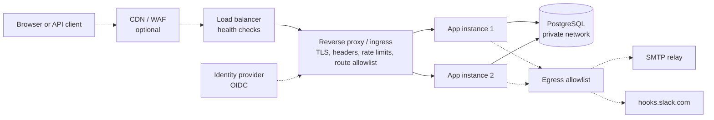
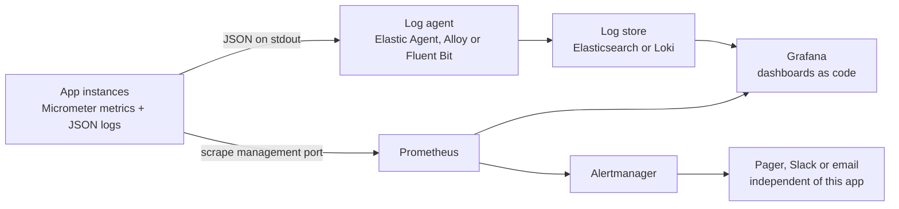

# 03 — Security, Observability and Delivery Proposal

> **Status:** DRAFT v0.2 for review · **Phase 1 follow-up: design only, no code** · **Branch:** `feature/planning` · **Date:** 2026-11-10
> **Companions:** [01-PLAN-OF-ATTACK.md](01-PLAN-OF-ATTACK.md) · [02-ARCHITECTURE-PROPOSAL.md](02-ARCHITECTURE-PROPOSAL.md) · **Project directives:** [CLAUDE.md](../CLAUDE.md)
> This document answers four review questions. Its new IDs continue the series of docs 01 and 02: plan-impact items `P-01 … P-13` (§5), decisions `D-21 … D-31` (§6), assumptions `A-21 … A-26` and questions `Q-11 … Q-14`, now answered (§7). No Dockerfile, compose file, manifest, pipeline or code is written in this phase.

## 0. Short answers

| Your question | Short answer | Where |
|---|---|---|
| What are the numbers in `destinationIds`? | Ids of the user's saved **destinations** (rows of `channel_destinations`), not channel ids. A destination is "this Slack webhook" or "this email address". | §1 |
| How do we secure user data and endpoints? | In layers. At the edge: a TLS-terminating reverse proxy or ingress behind a load balancer, with rate limits, security headers and a route allowlist (blueprint, optional sample config). In the app: ownership checks, secret masking, SSRF controls, quotas, strict browser headers, and an identity stub that **refuses to start outside the local profile**. In production: OIDC login at the edge plus JWT verification in the app. Optional: field-level encryption of webhook secrets. | §2 |
| Monitoring: Spring metrics, Prometheus, Grafana, ELK? | Yes to Micrometer (Spring's metrics layer), scraped by Prometheus and shown in Grafana, with dashboards and alert rules kept as code. Logs are structured JSON on stdout. ELK is compatible but not shipped; if we ship a log stack in the optional compose profile it is Loki, which is lighter and reuses Grafana. | §3 |
| How do we ship it? | A hardened Docker image plus a docker-compose file (app, PostgreSQL, fake SMTP) as the delivery artifact. Kubernetes as reference manifests only, not cluster-tested. CI on GitHub Actions as a stretch item. | §4 |

**Tiers used throughout.**
**A** = built and tested inside the 24 h plan.
**B** = optional packaging shipped in the repo (compose profiles, sample configs and manifests); needs your OK and spare time.
**C** = production blueprint: documented here, not built, not tested, and we will not claim otherwise.

## 1. What `destinationIds` means

The numbers are the **ids of destinations**: rows of the `channel_destinations` table that the user created through `POST /destinations`. They are not channel ids.

| Concept | What it is | Example | Identified by |
|---|---|---|---|
| **Channel** | A kind of delivery mechanism, implemented by an adapter | `EMAIL`, `SLACK` | A type code (text) |
| **Destination** | A user's saved contact point on one channel | Alice's `#ops-alerts` webhook; `alice@example.com` | A numeric `id` |
| **Rule** | What the user cares about, plus which destinations to use | "Big quakes" with `destinationIds: [1, 2]` | A numeric `id` |
| **Notification** | One delivery of one event to one destination because of one rule | Event 7 to destination 1 because of rule 3 | A numeric `id` |

Worked example. Alice creates two destinations and receives their ids: `1` for her Slack webhook, `2` for her email address. She then creates a rule with `destinationIds: [1, 2]`. When an event matches the rule, the system creates two notifications, one for destination 1 (delivered by the Slack adapter) and one for destination 2 (delivered by the Email adapter).

Why ids and not channel names: a user can have several destinations on the same channel (two Slack channels, a work and a personal address), so the channel type alone cannot say where to send. The ids must exist, belong to the same user and be ACTIVE; a rule needs one to ten of them. The UI shows destination labels as checkboxes, so ids are an API detail. The same text is now in [doc 02 §7.1](02-ARCHITECTURE-PROPOSAL.md#71-rule-anatomy).

## 2. Security

### 2.1 What we protect

| Data | Where it lives | Sensitivity | Main risk | Protection |
|---|---|---|---|---|
| User email and display name | `users` | PII, medium | Disclosure, enumeration | Ownership checks; masked in admin lists; no passwords stored (production identity is delegated to an identity provider) |
| Destination email addresses | `channel_destinations.config` | PII, medium; may belong to a third party (A-08) | Disclosure; use as a spam target | Masked outside the owner's own view; quotas; confirmation flow (tier C) |
| Slack webhook URLs | `channel_destinations.config` | **Secret**: whoever holds the URL can post to that channel | Leak through a database dump, logs or an API response | Masked everywhere; never logged; optional field-level encryption (P-05); SSRF allowlist |
| Rules and notification history | `alert_rules`, `notifications` | Low to medium: reveals what a user watches (a ticker, a region) | Disclosure, profiling | Ownership checks; retention policy (tier C) |
| Audit log | `audit_log` | Medium | Tampering, disclosure | Append-only; admin-only read |
| Operational secrets: database and SMTP passwords, encryption keys | Environment or secret store | **Critical** | Leak through git, images or logs | Never in git or images; injected at runtime; documented rotation |
| Logs, metrics, traces | Log store, Prometheus | Low if designed well | PII leakage | Redaction by design; masked identifiers; no bodies on sensitive endpoints; access control on the log store |
| Backups and replicas | Backup storage | Same as the source data | Weaker access control than the database | Encrypted; same access policy; restore-tested (tier C) |

### 2.2 Defense in depth: reference topology

| Layer | Responsibility | Typical products | Tier |
|---|---|---|---|
| Edge / WAF (optional) | Absorb DDoS, generic web-attack rules, bot filtering | Cloud CDN and WAF, ModSecurity | C |
| Load balancer | Spread traffic across instances, health checks, cross-zone failover, L4 passthrough or L7 | Cloud load balancer, HAProxy, nginx | C (B: nginx in the compose edge profile) |
| Reverse proxy, ingress or gateway | TLS 1.2+ termination, HTTP to HTTPS redirect, HSTS, security headers, per-IP and per-user rate limits, request size and timeout limits, route allowlist (block management paths; optionally restrict admin paths to a VPN or office range), forwards identity | nginx, Traefik, Envoy Gateway, cloud gateways. Ingress NGINX was retired in March 2026, so for new clusters choose a maintained controller or the Gateway API. | B (sample config) / C |
| Authentication gateway | OIDC login and session; forwards a signed token to the app | oauth2-proxy, gateway external-auth features, or the app itself | C |
| Application | Token verification, ownership and role checks, validation, output escaping, quotas, SSRF controls, security headers for static files, problem+json errors without internals | Spring Boot | A |
| Data | Private network only, TLS, least-privilege roles, encrypted storage and backups | Managed PostgreSQL | C (A: configuration supports it) |
| Egress | Outbound allowlist: the SMTP relay and `hooks.slack.com` only | NAT with allowlist, egress proxy, NetworkPolicy | C (A: in-app SSRF controls) |
| Secrets | Hold and rotate credentials, audit access | Kubernetes Secrets with KMS encryption, External Secrets, Vault, cloud secret managers | C |

The application stays **stateless** (identity is verified on every request, no server-side session), so the load balancer needs no sticky sessions.

### 2.3 Identity and access

**Today (A-10, tier A).** The stub reads an `X-User-Id` header to pick a seeded user. Anyone who can reach the app could impersonate anyone, so the stub is demo-only. We add a **fail-closed guard** (P-01): the stub is permitted only while the `local` profile is active. With any other profile the application refuses to start unless a separate, loudly named override is set. A start-up test proves it. The "view as" switcher in the UI exists only in `local`.

**Production path (recommended, tier C, D-22).**

1. The browser asks for the app. The edge finds no session and redirects to the company identity provider (OIDC authorization code flow with PKCE). Password policy and MFA are the identity provider's job.
2. After login the edge sets an encrypted `HttpOnly`, `Secure`, `SameSite=Lax` session cookie. Tokens never reach browser JavaScript.
3. For each request the edge forwards a short-lived signed token (a JWT) to the app.
4. The app, acting as an OAuth2 resource server, verifies signature, issuer, audience and expiry on every request. It never trusts a bare identity header.
5. The app maps claims to `CurrentUser`: the user id from the subject claim, the email, and the role from an identity-provider group claim. The first request of a new user creates the `users` row (just-in-time provisioning). Only an identity-provider group can grant ADMIN.
6. Network rule: the app accepts connections only from the proxy network. Together with token verification, bypassing the proxy is not enough to impersonate anyone.
7. State-changing endpoints accept only `application/json`. With `SameSite` cookies and no CORS this blocks cross-site form attacks (CSRF). A CSRF token is added if the organization requires one.

**Options considered**

| Option | How it works | Pros | Cons | Verdict |
|---|---|---|---|---|
| Identity headers only (trusted proxy) | The proxy authenticates and sets a user header; the app trusts it | Simplest | Any bypass of the proxy means full impersonation; no cryptographic binding | Rejected (this is what the stub does, so local only) |
| **OIDC at the edge, JWT verified in the app** | As in the steps above | Stateless; defense in depth; identity-provider agnostic; works behind any load balancer | Needs an edge authentication component | **Recommended** |
| In-app OAuth2 login with server-side sessions | The app handles the redirect and keeps a session | No extra component | Sessions need a shared store or sticky sessions across replicas; more application code | Alternative when no edge authentication exists |
| Single-page app obtains tokens itself (PKCE) and keeps them in memory | The browser holds the access token | Stateless, no cookies | A token is reachable by injected script; refresh handling in JavaScript | Alternative, only with a strict CSP |

**Machine clients (event publishers).** The push API is for systems, not people. Production needs OAuth2 client credentials with a narrow scope (for example `events:write`), or per-source API keys: random, shown once, stored as a hash, rotatable, bound to one source. In the build, the stub grants publishing to the ADMIN role.

**Authorization.** Roles USER and ADMIN plus ownership (tier A). Admin power is wide, so it is protected by MFA at the identity provider, the admin audit log (tier A) and optionally network restrictions (tier C). Later, ADMIN can be split into an OPERATOR (read, requeue) and an ADMIN (user and rule control).

### 2.4 Protecting user data

| # | Control | What we do | Tier |
|---|---|---|---|
| 1 | Data minimization | Store only email, display name and destination configs. No passwords, phone numbers or addresses. | A |
| 2 | Encryption in transit | Browser to edge: TLS 1.2+ (1.3 preferred). Edge to app: TLS across untrusted networks, or mesh mTLS. App to PostgreSQL: TLS with certificate verification. App to SMTP: STARTTLS required in LIVE mode (P-04). App to Slack: HTTPS only. | A (SMTP, Slack) / C |
| 3 | Encryption at rest, platform | Encrypted volumes or managed-database encryption; encrypted backups | C |
| 4 | Encryption at rest, field level | Destination secrets (Slack webhook URLs, optionally email addresses) encrypted by the app with AES-256-GCM: random nonce per value, key id stored with the ciphertext, destination id bound as associated data so ciphertext cannot be moved between rows. Key ring from the environment or a KMS. Rotation: add a new primary key, re-encrypt in the background, retire the old key. `destination_key` stays a one-way hash, so duplicates are still detected without plaintext. | A if approved (P-05, D-23), otherwise C |
| 5 | Masking | API responses, logs and UI mask secret fields, and partially mask emails outside the owner's own view (I-7) | A |
| 6 | Log hygiene | No request or response bodies on destination endpoints; user ids rather than emails as log identifiers; an automated test proves secrets never appear in captured logs (I-7) | A |
| 7 | Access control | Ownership checks in every service method; admin actions audited (I-9) | A |
| 8 | Database privileges | Two roles: the application (data changes only) and the migrator (schema changes). No superuser. Private network. | C (A: Flyway can use separate credentials by configuration) |
| 9 | Secrets management | No secrets in git, images or logs. `.env.example` holds placeholders only. Environment variables locally; Kubernetes Secrets with KMS encryption, External Secrets or Vault in production. Documented rotation for database, SMTP and encryption keys. | A (rules) / C (tooling) |
| 10 | Retention and deletion | Soft delete exists (D-11). A scheduled purge (illustratively: notifications and attempts after 90 days, events after 180, audit after one year) and user export and erasure endpoints are production requirements. | C |
| 11 | Backups | Encrypted, access-controlled, restore-tested; point-in-time recovery from the managed database | C |
| 12 | Third-party data | Destinations can point at other people's mailboxes (A-08). Mitigate with quotas (A), a per-user daily email cap (could), and double opt-in confirmation (C, recommended before any public use). | A / C |

### 2.5 Protecting endpoints

| Concern | Control | Where | Tier |
|---|---|---|---|
| Transport security | TLS 1.2+, HSTS, HTTP to HTTPS redirect, modern ciphers | Edge | B / C |
| Authentication | As in §2.3 | Edge and app | C (A: guarded stub) |
| Authorization | Roles and ownership; admin-only paths; foreign ids answer 404 | App | A |
| Rate limiting | Per-IP and per-identity limits at the edge, tighter on write and admin paths. In-app quotas are always on. An in-app token bucket (for example Bucket4j) only if no edge exists: new dependency, not planned. | Edge, app | B (sample config) / A (quotas) |
| Request limits | Body limit 64 KB, header limits, connect and read timeouts, maximum connections per IP | App, edge | A (app) / B |
| Input validation | Bean validation, strict JSON, allowlisted enumerations, field limits | App | A |
| Output encoding | Email HTML escaping; Slack escaping; the UI inserts text, never HTML | App, UI | A |
| Browser hardening | Same-origin only (no CORS). A Content-Security-Policy that allows only our own scripts and styles, with no inline code (possible because Tailwind is prebuilt, A-18). `X-Content-Type-Options: nosniff`, `frame-ancestors 'none'`, strict `Referrer-Policy`, a `Permissions-Policy` denying unused features. Cookies `Secure`, `HttpOnly`, `SameSite` once sessions exist. | App (static files), edge | A (P-02) |
| Management endpoints | Actuator on a separate management port bound to the internal network. Only health, info and prometheus are exposed. Never routed by the edge. | App, edge | A (P-03) / B |
| Admin surface | Role check in the app; MFA at the identity provider; optionally restricted to a VPN or office range at the edge | App, edge | A / C |
| Error handling | problem+json with stable codes; no stack traces, class names or server banners | App | A |
| SSRF and egress | Webhook host allowlist, https only, no redirects, private addresses refused, checked on save and on send (A). Network egress allowlist (C). | App, network | A / C |
| Supply chain | Few dependencies with pinned versions; automated dependency updates; dependency review and code scanning in CI; image scanning; SBOM | CI | B |
| Container and cluster hardening | Non-root user, read-only root file system, no extra capabilities, resource limits, default-deny NetworkPolicy, restricted pod security | Image, cluster | B (image, sample manifests) / C |
| Detection | Metrics for authentication failures, 4xx and 5xx rates and rate-limit hits; alerts on spikes | App, Prometheus | A (metrics) / B (alerts) |

### 2.6 How we would verify it

| Control | Test or check | Milestone |
|---|---|---|
| Stub guard | Start-up test: a non-local profile with the stub enabled fails fast | M3 |
| Ownership and roles | Authorization matrix tests (I-9) | M3–M6 |
| Masking and log hygiene | API tests and log-capture tests (I-7) | M4, M8 |
| SSRF | Tests for private addresses, redirects, non-https and other hosts | M4, M5 |
| Field-level encryption (if approved) | Round trip; tamper test (a changed ciphertext or associated data fails); rotation with two keys; no plaintext in the database or logs | M4 |
| Security headers | Test asserting headers and CSP on `/` and static assets | M7 |
| Management port | Test: actuator is not reachable on the main port; prometheus only on the management port | M5 |
| Dependencies and image | CI scans (tier B) | stretch |
| Whole system | Optional OWASP ZAP baseline scan against the running app (tier C) | — |

### 2.7 Residual risks and non-claims

- The 24 h build is **not production-ready from a security standpoint**: identity is a stub (local only), there is no WAF, no secret manager, no mTLS, and destinations are unverified.
- Slack webhook URLs are bearer secrets. Without P-05 they are stored in plaintext in the database, masked in every output (RISK-08).
- Rate limiting in the build is quotas only. Real throttling belongs to the edge.
- We claim compliance with no standard (GDPR, SOC 2, ISO 27001). Q-12 asks which applies.

## 3. Observability

### 3.1 The stack at a glance

| Concern | Choice | Alternatives | Why | Tier |
|---|---|---|---|---|
| Instrumentation | Micrometer through Spring Boot Actuator (what "Spring metrics" means) | OpenTelemetry SDK directly | Built into Spring Boot, vendor-neutral, gives JVM, HTTP and database metrics for free, plus our `alerting.*` meters (doc 02 §11.3) | A |
| Metrics endpoint | Prometheus text format at `/actuator/prometheus` on the management port (needs the Prometheus registry dependency, A-24) | OTLP push | The pull model is simple and standard; no agent inside the app | A (P-06) |
| Metrics store | Prometheus | VictoriaMetrics, Mimir, managed services | De facto standard; a single binary; runs in compose | B / C |
| Dashboards | Grafana, with datasources and dashboards provisioned from files in the repo | Kibana, vendor UIs | Dashboards as code are reviewable and reproducible | B |
| Alerting | Prometheus alert rules (in the repo) routed by Alertmanager to Slack, email or a pager | Grafana alerting, vendor alerting | Rules are versioned with the code; routing is operational configuration | B (rules) / C (routing) |
| Logs: emit | JSON in the ECS field format on stdout, using Spring Boot structured logging | Plain text, log files | One format works for ELK, Loki and cloud services; no file handling in containers | A |
| Logs: collect and store | **Not shipped by default.** The operator chooses: Elastic Stack (agent, Elasticsearch, Kibana), OpenSearch, Grafana Loki with Grafana Alloy (Promtail reached end of life in March 2026), or a cloud service. The optional compose profile would ship Loki and Alloy. | ELK in the repo | ELK needs several GB of RAM and security set-up; Loki is lighter and reuses Grafana. Because the app only writes JSON to stdout, the choice is operational, not architectural. | B (Loki) / C (ELK) |
| Tracing | Deferred. Correlation ids in logs cover our asynchronous hops. OpenTelemetry tracing (Micrometer Tracing, OTLP, Tempo or Jaeger) can be added without design change. | — | Low value in a monolith with few external hops | C |
| Health | Spring Boot health groups: liveness and readiness, plus per-channel indicators | — | Probes for load balancers and Kubernetes | A |

### 3.2 Metrics

- **Pipeline metrics** are defined in doc 02 §11.3 (ingest results, match duration, notifications by status, delivery attempts and latency per channel, queue depth, oldest pending age, lost leases, invalid rules).
- **Platform metrics** come from Micrometer's built-ins: JVM memory, garbage collection and threads, HTTP server request rate, errors and latency histograms, database pool usage, log event counts, CPU and uptime.
- **Label rules.** Labels use bounded sets only: channel, outcome, category, source, status, result. Never a user, rule or event id: those explode cardinality and belong in logs.
- Latency metrics publish histograms, so Prometheus can compute percentiles across instances.

### 3.3 Dashboard (tier B, P-07)

One provisioned dashboard, "Alerting pipeline":

| Row | Panels |
|---|---|
| Pipeline | Events ingested per minute by result; match duration p95; candidate rules versus matches; notifications created by status |
| Delivery | Attempts per minute by channel and outcome; delivery latency p95 by channel; queue depth by status; oldest pending age |
| Failures | Notifications turning DEAD; lost leases; invalid rules; events FAILED; latest error codes by channel |
| Platform | HTTP request rate, error ratio and p95; JVM heap and GC pause; database pool active and pending; CPU |

### 3.4 Service levels and alerts

Illustrative objectives, to be challenged (Q-06):

| Indicator | Objective |
|---|---|
| Ingest availability (non-5xx responses) | 99.9 % per month |
| Ingest latency | p95 under 300 ms |
| Time from notification creation to first attempt | 99 % within 10 s (matches A-12) |
| Delivery effectiveness | 99 % of notifications with a valid destination end SENT |

Alert catalog (rules in the repo, tier B; routing is operational, tier C):

| Alert | Condition | Severity | First response |
|---|---|---|---|
| NotificationQueueStale | Oldest pending age above 60 s for 5 minutes | Page | Check the dispatcher, paused channels, the database |
| DeadLettersRising | More than 10 notifications turn DEAD within 10 minutes | Page | Inspect error codes in the admin console |
| ChannelFailing | Failure ratio of one channel above 50 % for 10 minutes | Page | Provider outage or credentials (for example `SMTP_AUTH`) |
| LeaseLostSpike | More than 5 lost leases in 10 minutes | Ticket | Compare adapter timeouts with the lease |
| IngestErrors | 5xx ratio above 2 % for 5 minutes | Page | Check the database and application logs |
| EventsStuck | Any event RECEIVED for more than 5 minutes, or any FAILED | Ticket | Matcher errors |
| DbPoolSaturated | Pool usage above 90 % for 5 minutes | Ticket | Connection leaks, slow queries |
| JvmMemoryHigh | Heap above 90 % for 10 minutes | Ticket | Sizing, leaks |
| AuthFailureSpike | Authentication failures or 403 responses above baseline | Ticket | Probing or misconfiguration (production) |

**Do not alert through our own channels about our own failure.** Operational alerts go through Alertmanager's receivers, so a broken alerting service can still page someone.

### 3.5 Logs

- **Format.** JSON with ECS field names: timestamp, level, message, service name and version, environment, logger, thread. MDC fields: `requestId`, `eventId`, `notificationId`, `ruleId`, `channel`, `workerId`. Error type, message and stack trace only for unexpected errors.
- **Levels.** INFO for lifecycle (event accepted, rules matched, notification sent or dead), WARN for retries and lost leases, ERROR for unexpected exceptions, DEBUG off by default. One INFO line per state change is acceptable inside the design envelope (A-12); beyond it, aggregate instead.
- **Never logged.** Secrets, destination configs, full email addresses, request bodies of destination endpoints.
- **Correlation.** `requestId` is generated at the edge or taken from `X-Request-Id`. `eventId` follows an event through matching and dispatch, so one query reconstructs an alert's journey.
- **Shipping.** Containers write to stdout; a node or host agent (Elastic Agent or Filebeat, Alloy, Fluent Bit) tails them and forwards to the store. No sidecar and no multi-line parsing, because each line is one JSON object.
- **Retention and access.** For example 14–30 days searchable and longer archived, with access limited to operators. The database `audit_log` is the system of record for admin actions, not the logs.

### 3.6 Other signals

Error tracking (for example Sentry) and synthetic external probes are optional and tier C. Java Flight Recorder can be enabled on demand for profiling.

### 3.7 Reviewer experience

Default `./gradlew bootRun`: health and metrics endpoints only, no extra software. Optional `docker compose --profile observability up`: Prometheus, Grafana with the dashboard preloaded (local-only credentials), and optionally Loki with Alloy. Nothing in the observability profile is needed to run or test the app.

## 4. Delivery: how we ship it

### 4.1 What we ship

| Artifact | Purpose | Tier | Item |
|---|---|---|---|
| Source plus Gradle wrapper | Run and test from source | A | — |
| Executable JAR | Run anywhere a JRE 25 exists | A | — |
| Container image (multi-stage Dockerfile) | The deployable unit | B, recommended | P-09 |
| docker-compose (app, PostgreSQL, fake SMTP; profiles) | A production-like local run for reviewers | B, recommended | P-10 |
| Compose `edge` profile (reverse proxy, two replicas) | Shows TLS, headers, rate limits, load balancing and multi-node safety | B, stretch | P-11 |
| Compose `observability` profile | Prometheus, Grafana, alert rules, optional Loki | B, stretch | P-07, P-08 |
| Kubernetes reference manifests (Kustomize) | How it would be deployed | B, stretch; not cluster-tested | P-12 |
| CI workflow | Automated build, test, scans, image | B, stretch | P-13 |

### 4.2 Container image (D-28)

- **Multi-stage build.** A build stage with JDK 25 and the Gradle wrapper; a runtime stage with a JRE 25 base image only (an Eclipse Temurin or equivalent vendor image, pinned by digest; the exact tag is verified in M9).
- **Layered jar**, so dependency layers are cached between builds.
- **Hardening.** Non-root numeric user, read-only root file system with a writable temporary directory, no secrets baked in, `.dockerignore`. A distroless-style base removes the shell at the cost of harder debugging.
- **JVM in containers.** Container-aware heap sizing (a percentage of the memory limit), exit on out-of-memory so the orchestrator restarts the container, virtual threads enabled through a Spring property.
- **Shutdown.** The JVM is process 1 and receives SIGTERM; Spring's graceful shutdown stops claiming work and drains in-flight sends (§4.9).
- **Health check.** Readiness on the management port. **Labels.** OCI source, revision and version.
- **Alternatives.** Cloud Native Buildpacks (less to maintain, good defaults, still needs Docker, less transparent). Jib (no Docker daemon, an extra Gradle plugin). GraalVM native image (faster start, but reflection and ahead-of-time constraints add risk to a 24 h build): rejected.

### 4.3 Configuration and secrets

Twelve-factor: all configuration comes from the environment; secrets are injected at runtime and never baked into the image. Names below are the environment forms of Spring properties.

| Variable | Purpose | Secret |
|---|---|---|
| `SPRING_PROFILES_ACTIVE` | `local`, `postgres` or `prod` | no |
| `SPRING_DATASOURCE_URL`, `_USERNAME`, `_PASSWORD` | Application database access (data changes only, in production) | password |
| `SPRING_FLYWAY_URL`, `_USER`, `_PASSWORD` | Migration role (schema changes), used by a separate migration step in production | password |
| `SPRING_MAIL_HOST`, `_PORT`, `_USERNAME`, `_PASSWORD` | SMTP relay | password |
| `ALERTING_CHANNELS_EMAIL_MODE`, `ALERTING_CHANNELS_SLACK_MODE` | `DRY_RUN` or `LIVE` | no |
| `ALERTING_CHANNELS_SLACK_ALLOWED_HOSTS` | SSRF allowlist | no |
| `ALERTING_CRYPTO_KEYS`, `ALERTING_CRYPTO_PRIMARY_KEY_ID` | Field-encryption key ring (only if P-05 is approved) | yes |
| `ALERTING_IDENTITY_MODE` | `HEADER_STUB` (local only) or `JWT` (production) | no |
| `MANAGEMENT_SERVER_PORT` | Internal management port | no |
| `LOGGING_STRUCTURED_FORMAT_CONSOLE` | `ecs` | no |

Start-up validation fails fast when required settings are missing, refuses the stub outside `local`, and refuses `DRY_RUN` with the `prod` profile unless explicitly overridden (a silent dry run in production would quietly drop real alerts).

### 4.4 docker-compose (P-10, recommended)

- **Services.** `app` (our image); `postgres` (a pinned major version, with a volume, not published to the host); `mailpit` (a fake SMTP server with a web inbox, so Email-channel output can be seen); optionally a `slack-stub` (an HTTP stub that answers like a webhook, so LIVE Slack mode can be shown without a real workspace).
- **Networks.** `backend`, internal (app to database). `edge` for published ports.
- **Profiles.** Default (app, postgres, mailpit); `edge` (adds a reverse proxy and a second app replica); `observability` (adds Prometheus, Grafana, optionally Loki and Alloy).
- **Configuration** through an env file: `.env` is git-ignored, `.env.example` is committed with placeholders only.
- **Start order** is health-gated: database healthy, then app ready, then proxy.
- It also gives the app a **PostgreSQL run**, which reduces RISK-04.

### 4.5 Edge profile: reverse proxy and load balancer (P-11, stretch)

| What it demonstrates | Mechanism |
|---|---|
| TLS termination | A self-signed certificate for local use; HTTP to HTTPS redirect; HSTS |
| Security headers | Added at the proxy in addition to the app's own |
| Rate limiting | A per-IP request limit with burst, stricter on write paths |
| Request limits | Body size 64 KB; upstream timeouts |
| Route allowlist | `/actuator/*` and the management port are unreachable from outside; the admin API can optionally be restricted by source range |
| Load balancing | Least-connections across two replicas with passive health checks; no sticky sessions, because the app is stateless |
| Multi-node safety | DS-1 … DS-5 run through the proxy against two replicas, asserting no duplicate sends (invariant I-3 under real load balancing) |

nginx is used for the sample because it is widely known and has mature rate limiting; Traefik and Envoy Gateway are equally valid, and in a cloud the platform's managed load balancer and gateway take this role. DRY_RUN failure injection lives in memory, so with two replicas it applies only to the replica that received the call (local-only feature, documented).

### 4.6 Kubernetes reference (P-12, stretch, D-29)

A Kustomize base with dev and prod overlays:

| Manifest | Content |
|---|---|
| Namespace, ServiceAccount | A dedicated namespace; a service account with no extra permissions |
| Deployment | Two replicas; rolling update with zero unavailable; startup, readiness and liveness probes on the management port; resource requests and limits; non-root and read-only security context; a termination grace period longer than the drain time; a pre-stop delay so the load balancer deregisters first |
| Service | Cluster-internal |
| Ingress or Gateway API route | TLS issued by cert-manager; a maintained controller (not Ingress NGINX); management paths not routed |
| ConfigMap, Secret template | Configuration; a secret template with no values, filled by External Secrets or sealed secrets |
| PodDisruptionBudget | Keeps one replica available during node maintenance |
| HorizontalPodAutoscaler | CPU-based. Scaling on queue depth through KEDA or the Prometheus adapter is tier C. |
| NetworkPolicy | Default deny; allow proxy to app, app to database, app to DNS, app to the SMTP and Slack egress |
| ServiceMonitor | For clusters running the Prometheus Operator |
| Migration Job (optional) | Runs schema migrations with the migrator role |

The database is a managed PostgreSQL service outside the cluster (preferred), or an operator-managed cluster where policy requires it. **Honest limits:** the manifests are written and checked with a client-side dry run, but **not deployed to a real cluster** in this exercise. Kustomize is used instead of Helm (no templating layer to maintain). There is no Terraform.

### 4.7 Database migrations in deployment (D-30)

- **Local and compose:** Flyway runs at application start. Simple.
- **Production:** a separate migration step (a Kubernetes Job or init step) with the migrator role; the application role has no schema privileges and starts with `ddl-auto=validate`.
- **Zero-downtime discipline: expand and contract.** A release may only add things the previous release ignores; removal happens one release later. This keeps rolling updates and rollbacks safe.
- **Concurrent starts.** Flyway locks while migrating, so replicas starting together do not corrupt the schema. The separate step is still preferred in production.

### 4.8 CI/CD (P-13, stretch, D-31)

GitHub Actions, one workflow:

| Stage | What | Gate |
|---|---|---|
| Build and test | JDK 25, Gradle wrapper 9.1 or newer, `./gradlew check`, dependency cache, publish test and coverage reports | Required check on every PR |
| Supply-chain checks | Dependency review, code scanning, vulnerability scan of dependencies | Required, advisory at first |
| Image build | Multi-stage Docker build tagged with the git SHA | On main and tags |
| Image scan and SBOM | Vulnerability scan; SBOM generation; fail on critical findings | Required for a release |
| Publish | Push to the container registry (GHCR) | Tags only |
| Deploy | Manual approval, per environment | Out of scope here |

Branch protection: a PR is required, checks must pass, one PR per milestone (doc 01 §5).

### 4.9 Releases, scaling, shutdown, backups

- **Versioning.** SemVer tags (`v0.1.0` and so on); images tagged by git SHA and by version; a changelog. Rollback means redeploying the previous image, which is safe because migrations are backward compatible (§4.7).
- **Scaling.** Run N replicas against one database; each runs the dispatcher and the sweeper, and leases make that safe (I-3). Capacity rule: replicas times pool size must stay below the database connection limit. Scale on CPU first; queue depth and oldest pending age are the business signals (autoscaling on them is tier C).
- **Graceful shutdown.** On SIGTERM the instance reports not ready, stops claiming, lets in-flight sends finish (adapter timeouts are at most 10 s; shutdown timeout 30 s), then exits. The 60 s lease covers anything left over. The platform's grace period must exceed the shutdown timeout.
- **Backups and recovery.** Managed PostgreSQL with point-in-time recovery; illustrative targets RPO 5 minutes and RTO 1 hour; restore drills (tier C).
- **Growth and retention.** Notifications and attempts are the growing tables, so a purge job is mandatory in production (A-13).

### 4.10 Compose or Kubernetes: when to choose which

| Situation | Choose | Why |
|---|---|---|
| This exercise; one VM; a small team | Compose with PostgreSQL | Few moving parts |
| The organization already runs Kubernetes with a gateway, secrets handling and monitoring | Kubernetes with the reference manifests | Reuses platform services |
| Autoscaling on queue depth, multi-zone availability | Kubernetes | HPA or KEDA, disruption budgets, topology spread |
| The simplest possible reviewer experience | `./gradlew bootRun`, no containers | A-02 |

## 5. Plan impact

The budget in doc 01 (20 h of work plus a 4 h reserve) is **unchanged until you choose a package**. After that we update doc 01 §6 and §7 and A-16, and doc 02 §9 (management endpoints move to the internal port) and §11.2–11.3.

### 5.1 Proposed additions

| ID | Item | Tier | Est. (h) | Lands in | Approval |
|---|---|---|---|---|---|
| P-01 | Fail-closed identity stub: allowed only in the `local` profile; start-up guard and test | A | 0.25 | M3 | no (cheap safety) |
| P-02 | Security headers and strict CSP for the static UI; same-origin only; header test | A | 0.25 | M7 | no |
| P-03 | Management port separation; expose only health, info and prometheus | A | 0.10 | M1 | no |
| P-04 | Require STARTTLS in LIVE mode; TLS settings documented | A | 0.10 | M5 | no |
| P-05 | Field-level encryption of destination secrets (AES-GCM, key ring, rotation notes, tests) | A | 1.00 | M4 | **[APPROVAL]** (A-23, D-23) |
| P-06 | Prometheus registry and `/actuator/prometheus` on the management port | A | 0.25 | M5 | **[APPROVAL]** (A-24, new dependency) |
| P-07 | Observability compose profile: Prometheus, Grafana, one provisioned dashboard, alert rules | B | 1.25 | after M8 | stretch |
| P-08 | Loki and Alloy in the observability profile (ELK stays documented) | B | 0.75 | after M8 | stretch |
| P-09 | Multi-stage Dockerfile: non-root, layered, health check, `.dockerignore` | B | 0.50 | M9 | **[APPROVAL]** (A-25) |
| P-10 | docker-compose: app, PostgreSQL, fake SMTP, profiles, env example; PostgreSQL run of the scenarios | B | 0.75 | M9 | **[APPROVAL]** (A-25) |
| P-11 | Edge profile: reverse proxy, TLS, headers, rate limits, route allowlist, two replicas, no-duplicate check | B | 1.00 | after M8 | stretch |
| P-12 | Kubernetes reference manifests (Kustomize), client-side validated | B | 0.75 | after M8 | stretch |
| P-13 | GitHub Actions workflow: build, test, scans, image, SBOM | B | 0.75 | after M8 | stretch |

### 5.2 Packages

| Package | Includes | Extra hours | Reserve left (of 4.0) | Verdict |
|---|---|---|---|---|
| 0. Documentation only | Nothing new is built; this document is the deliverable | 0 | 4.0 | Safe; Docker and monitoring are only described |
| 1. Recommended | P-01, P-02, P-03, P-04, P-06, P-09, P-10 | 2.20 | 1.80 | Fits: cheap safety wins, a runnable container and a PostgreSQL run |
| 2. Recommended plus encryption | Package 1 and P-05 | 3.20 | 0.80 | Possible but thin: review time and slippage must come from the cut list |
| 3. Everything | P-01 … P-13 | 7.70 | not feasible | Needs a budget of roughly 28 h before any reserve, or dropping other scope |

Stretch items P-07, P-08, P-11, P-12 and P-13 (4.5 h in total) start only when we are ahead of schedule at a checkpoint, each with your OK.

### 5.3 Effect on milestones

| Milestone | Current (h) | Package 1 (h) | Package 2 (h) |
|---|---|---|---|
| M1 | 1.00 | 1.10 | 1.10 |
| M3 | 2.00 | 2.25 | 2.25 |
| M4 | 3.50 | 3.50 | 4.50 |
| M5 | 3.50 | 3.85 | 3.85 |
| M7 | 3.00 | 3.25 | 3.25 |
| M9 | 1.00 | 2.25 | 2.25 |
| Others (M0, M2, M6, M8) | 6.00 | 6.00 | 6.00 |
| **Total work** | **20.00** | **22.20** | **23.20** |

### 5.4 What your answers (Q-11 … Q-14) change

| Answer | Effect on this proposal |
|---|---|
| **Q-11:** runs locally, on local infrastructure | The MVP runtime is a developer machine: `./gradlew bootRun` or docker-compose. Docker and compose (P-09, P-10) are the natural packaging. Kubernetes stays reference-only (D-29), and the production topology (A-26) and the OIDC path (D-22) stay documentation. |
| **Q-12:** an MVP with simulated data | No compliance regime applies and no real personal data exists. Retention, erasure and consent work stays blueprint (tier C), and the unverified-destination abuse risk (A-08) is negligible for now. Field-level encryption (P-05) is not needed for the MVP, so Package 2 is hard to justify. |
| **Q-13:** no existing stack, starting from zero | No integration constraint. If we ship an observability profile it is Prometheus and Grafana first (P-07), then Loki with Alloy (P-08). ELK is not needed. Both remain stretch items. |
| **Q-14:** not answered; inferred from Q-11 | Kubernetes is not the runtime for now. Please correct this if Kubernetes is the actual target. |

**Resulting recommendation: Package 1 (2.20 h).** It fits the budget, matches the local-infrastructure answer, and keeps 1.80 h of reserve. Package 2 stays available if you want encryption anyway. The package choice itself is still open until you confirm it.

## 6. Decisions

Every decision is **PROPOSED** until you approve or change it.

| ID | Decision | Alternatives considered | Why | Challenge this if… |
|---|---|---|---|---|
| D-21 | Layered edge: TLS terminates at a reverse proxy or ingress behind a load balancer; the app trusts forwarded headers only from the proxy and still sets its own security headers | The app terminates TLS itself; TLS passthrough to the app | One place for TLS, rate limits and route control; standard operations | You cannot run a proxy (then the app terminates TLS and limits rates itself) |
| D-22 | Production authentication: OIDC at the edge, signed token verified by the app as a resource server; machine clients use client credentials or hashed API keys | Identity headers only; in-app sessions; tokens held by the single-page app | Stateless, scales behind any load balancer, no trust in bare headers, tokens never in browser JavaScript | The organization has no edge authentication or different identity flows |
| D-23 | Field-level AES-256-GCM encryption of destination secrets with a key ring (if approved) | Platform encryption only; hashing (not reversible, so unusable here) | Limits the blast radius of database dumps and backups for about 1 h of work | Platform encryption plus access control is judged sufficient |
| D-24 | Management endpoints on a separate internal port; only health, info and prometheus exposed | Same port with path rules | Hard to expose by mistake; probes and scrapes stay internal | — |
| D-25 | Metrics: Micrometer, Prometheus pull, bounded label sets; dashboards and alert rules as code | Push-based (OTLP) metrics; a vendor agent | Standard, simple, reviewable | The organization standardizes on another backend (Micrometer supports many) |
| D-26 | Logs: ECS JSON on stdout; aggregation is a platform concern; ELK documented, Loki with Alloy as the optional light profile | Ship ELK in compose; log to files | One format for any backend; no heavy stack in the repo | The organization mandates ELK (then only the agent configuration changes) |
| D-27 | Tracing deferred; correlation ids in logs | OpenTelemetry tracing now | Few hops; ids already tie ingest, match and dispatch together | A downstream channel needs distributed traces |
| D-28 | Docker multi-stage image: non-root, layered, JRE only; no native image | Buildpacks; Jib; GraalVM native | Transparent, hardened, no extra plugin | The organization mandates buildpacks or a platform builder |
| D-29 | Compose for local and reviewers; Kubernetes as Kustomize reference manifests; managed PostgreSQL in production | Helm chart; Terraform; in-cluster database by default | Small surface to maintain; honest about what is tested | The organization deploys only through Helm |
| D-30 | Migrations at start-up for local and compose; a separate step with a migrator role in production; expand and contract discipline | Always at start-up | Least-privilege application role; safe rolling updates | A single-role setup is mandated |
| D-31 | CI on GitHub Actions: build and test as required checks; scans, image and SBOM as stretch | Another CI system | The repository is on GitHub; matches the PR-per-milestone flow | Another CI system is mandated |

## 7. Assumptions and questions

| ID | Assumption | If wrong | Status |
|---|---|---|---|
| A-21 | **Production readiness is a blueprint.** This document describes how a real deployment would be secured and operated (tier C). We implement only tier A items and approved tier B items, and never claim more. | If production use is expected, real authentication and the tier C items become mandatory work (rough estimate +10–15 h). | PROPOSED |
| A-22 | **Authentication stays out of the build** (A-10), but the stub fails closed outside `local` (P-01). Production authentication is OIDC at the edge with JWT verification in the app (D-22). | If real authentication is required now: +4–6 h and a new dependency (Spring Security resource server). | PROPOSED |
| A-23 | **[APPROVAL] Destination secrets** are encrypted at the field level (P-05, D-23). Without approval they are stored in plaintext, masked in all output, and the risk stays in RISK-08. | Reject: doc 01 §7 stands as written. | PROPOSED |
| A-24 | **[APPROVAL] Observability.** Micrometer with the Prometheus registry (extends A-16), Prometheus and Grafana as an optional compose profile, logs as ECS JSON on stdout. ELK is compatible but not shipped; Loki with Alloy is the optional shipped choice. | If the organization uses another stack, only the optional profile changes. | PROPOSED |
| A-25 | **[APPROVAL] Packaging.** A multi-stage Docker image and a docker-compose file are part of the deliverable (Package 1). Kubernetes is reference-only; no Helm, no Terraform. | If Docker is unwanted, drop P-09 and P-10 (−1.25 h); A-02 stands alone. | PROPOSED |
| A-26 | **Production reference topology.** Managed PostgreSQL, at least two app replicas behind a platform load balancer and a maintained ingress or gateway controller, secrets in a secret manager. Since the MVP runs locally (Q-11), this is documentation only. | Different platform: the principles in §2 still apply; the sample manifests change. | PROPOSED |

| ID | Question | Answer (2026-11-10) | Effect on the plan |
|---|---|---|---|
| Q-11 | Where will this run (cloud, on premises), and is there an identity provider (Okta, Entra ID, Keycloak, …)? | **Answered:** right now it runs locally, on local infrastructure. The identity-provider part is implied: none in the MVP. | The MVP runtime is local (`bootRun` or compose). A-22 stands (guarded stub); A-26 and D-22 are blueprint only. |
| Q-12 | Which compliance regime applies (GDPR, SOC 2, ISO 27001, none) and what retention periods? | **Answered:** none for now; the MVP is built on simulated data. | No personal data and no compliance claims. Retention, erasure and GDPR stay tier C (§2.4, A-13). Weakens the case for P-05. |
| Q-13 | Is there an existing observability stack (ELK, Datadog, Grafana Cloud, …) we must integrate with? | **Answered:** no, we set up from zero. | Free choice: Prometheus and Grafana first, Loki second, ELK not needed (A-24, D-25, D-26). |
| Q-14 | Is Kubernetes the standard runtime, and which ingress or gateway controller is approved? | **Inferred, please confirm:** not for now, because the MVP runs locally (Q-11). | Compose is the runtime; Kubernetes manifests stay a stretch reference (A-25, D-29). |

## 8. Change log

| Date | Version | Change |
|---|---|---|
| 2026-11-10 | v0.1 | Initial draft: security, observability and delivery proposal; `destinationIds` clarified (also in doc 02 §7.1) |
| 2026-11-10 | v0.2 | Recorded the answers to Q-11 … Q-13 (Q-14 inferred) and their effect on the plan (§5.4, §7); recommendation narrowed to Package 1 |
